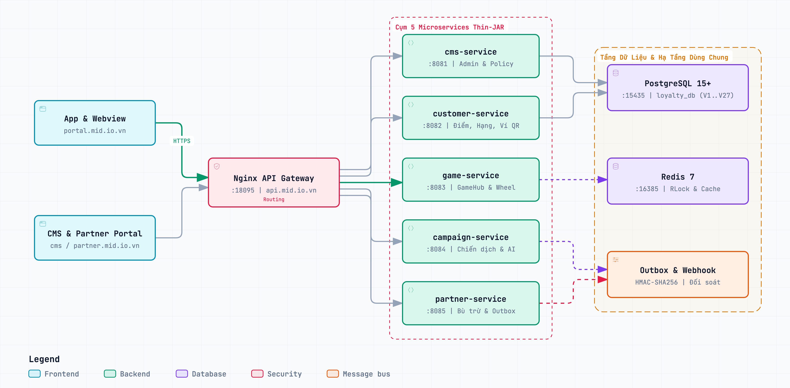

# HỆ SINH THÁI KHÁCH HÀNG THÂN THIẾT LIÊN MINH VÀ CỔNG GAME ĐA THUÊ BAO (MICRO-LOYALTY)

Tài liệu tổng quan hệ sinh thái phần mềm Dịch vụ Khách hàng thân thiết liên minh và Cổng Game đa thuê bao, cung cấp nền tảng tích điểm hợp nhất, phân hạng hội viên, liên thông Ví Phần Thưởng tại điểm bán và trò chơi hóa giải trí.

---

## 1. TỔNG QUAN HỆ THỐNG VÀ BỘ SẢN PHẨM BÀN GIAO

Hệ thống được thiết kế theo kiến trúc Microservices độc lập kết hợp Nginx API Gateway tập trung, phục vụ mô hình SaaS đa thuê bao bao trùm dịch vụ ví điện tử Natcash, mạng viễn thông Natcom và mạng lưới các đối tác thương mại bán lẻ liên minh.

<p align="center">
  <a href="diagrams/ecosystem-architecture.html" target="_blank" title="Bấm để mở sơ đồ tương tác toàn màn hình">
    
  </a>
</p>

### Bộ Sản Phẩm Bàn Giao Cốt Lõi:

| Thành phần | Mô tả kỹ thuật & Vai trò kiến trúc | Cổng mặc định |
| :--- | :--- | :---: |
| **`cms-service`** | Quản trị hệ thống, tham số động, phân quyền IAM/RBAC, chính sách điểm, đối tác, phê duyệt, dashboard và báo cáo | `8081` |
| **`customer-service`** | Tài khoản hội viên, phân hạng, sổ cái điểm FIFO, đổi quà Voucher, QR Ví Phần Thưởng động, SSO, USSD và đại lý | `8082` |
| **`game-service`** | Cổng GameHub, Vòng quay may mắn và ngân hàng câu hỏi Micro-Learning | `8083` |
| **`campaign-service`** | Chiến dịch, cột mốc nhiệm vụ, phân khúc hội viên, ngân sách đồng tài trợ, cảnh báo và AI Copilot | `8084` |
| **`partner-service`** | Đối soát bù trừ đa phương, cổng thanh toán bằng điểm, chi nhánh đối tác, Partner Portal API và Webhook Outbox | `8085` |
| **`loyalty-common`, `loyalty-engine`, `ims-libraries`** | Bộ thư viện lõi dùng chung cho cả 5 Microservices trên nền tảng Java 17 LTS / Spring Boot 3.5.3, quản lý cơ sở dữ liệu độc lập `loyalty_db` trên PostgreSQL 15+ (Flyway `V1`–`V41`) và khóa phân tán Redis 7 | Thư viện dùng chung |
| **`loyalty-saas-gateway`** | Nginx API Gateway điều phối lưu lượng công khai và nội bộ theo tiền tố đường dẫn URI tới 5 Microservices và 3 cổng giao diện | `18095` |
| **`loyalty-cms`** | Cổng thông tin quản trị trung tâm (ReactJS 18 / TypeScript / Vite / PrimeReact / Nginx) | `8990` (dev) |
| **`loyalty-webview`** | Cổng Webview nhúng di động (ReactJS 18 / TypeScript / Vite / TailwindCSS) tích hợp `LoyaltyJSBridge`, đĩa quay Canvas 60 FPS và sảnh GameHub | `3001` (dev) |
| **`loyalty-partner-portal`** | Cổng thông tin tự phục vụ dành cho đối tác liên minh đối soát bù trừ, quản lý chi nhánh và Voucher | `8991` (dev) |
| **`gamehub-sdk.js` / `loyalty-sandbox`** | Bộ SDK JavaScript tích hợp game HTML5 và cổng trình giả lập dành cho đối tác kiểm thử API & chữ ký HMAC-SHA256 | `8995` (dev) |
| **`natcash-eu-app` & `natcash-eu-api`** | Phân hệ tích hợp trên ứng dụng di động React Native và cổng chuyển tiếp API xác thực JWT của hệ sinh thái Natcash | Tích hợp ngoài |

---

## 2. CẤU TRÚC THƯ MỤC DỰ ÁN

```
micro-loyalty/
├── .agents/                            # Quy chuẩn phiên làm việc và kỹ năng tự động
├── ci-local.sh                         # Kịch bản CI cục bộ kiểm thử 20 module Maven, 3 Frontend & Docker Compose
├── diagrams/                           # Bộ sơ đồ kiến trúc và bản xuất tĩnh độ phân giải cao
├── deploy/                             # Gói đóng gói và triển khai phân lập theo 2 mô hình
│   ├── micro-loyalty/                  # Môi trường SaaS Đa Thuê Bao (35.247.156.176:65000 root)
│   │   ├── backend/                    # Dockerfile đa tầng Thin-JAR & gói xuất bản module/*.jar, lib/, etc/
│   │   ├── frontend/                   # Gói tĩnh & Dockerfile cho cms, webview, partner-portal
│   │   ├── gateway/                    # Dockerfile Nginx API Gateway
│   │   ├── config/                     # Cấu hình ngoại vi Backend, env-config.json & Nginx Virtual Hosts
│   │   ├── locales/                    # Từ điển đa ngôn ngữ ngoại vi (vi, en, fr, ht...)
│   │   ├── ci-cd/                      # Jenkinsfile Pipeline SaaS tự động theo phân hệ thay đổi
│   │   ├── monitoring/                 # Cấu hình giám sát hệ thống
│   │   ├── scripts/                    # Kịch bản quản trị start.sh, stop.sh, backup.sh, restore.sh, healthcheck.sh
│   │   ├── docker-compose.yml          # Cụm 11 vùng chứa SaaS khép kín (5 Microservices + Gateway + 3 FE + DB + Redis)
│   │   ├── deploy-guild.md             # Hướng dẫn chi tiết triển khai môi trường SaaS
│   │   └── .env.example                # Mẫu biến môi trường SaaS
│   └── natcash/                        # Môi trường On-Premise Tại Chỗ (10.228.37.65:22 mascom)
│       ├── backend/                    # Dockerfile & gói Thin-JAR phân lập cho Natcash
│       ├── frontend/                   # Gói tĩnh & Dockerfile Frontend phân lập cho Natcash
│       ├── config/                     # Cấu hình Backend, Nginx 8443/8080 & env-config.json Natcash
│       ├── locales/                    # Từ điển đa ngôn ngữ ngoại vi riêng của Natcash
│       ├── scripts/                    # Kịch bản cài đặt, nạp cấu hình và vận hành On-Premise
│       ├── docker-compose.yml          # Tệp Compose phục vụ triển khai container On-Premise
│       ├── deploy-guild.md             # Hướng dẫn chi tiết triển khai môi trường On-Premise
│       └── .env.example                # Mẫu biến môi trường Natcash
├── docs/                               # Hồ sơ tài liệu nghiệp vụ, kiến trúc và vận hành
│   ├── ba/                             # Tài liệu nghiệp vụ & thiết kế tiến hóa giải pháp
│   ├── dev/                            # Tài liệu kỹ thuật mã nguồn & tích hợp GameHub SDK
│   └── ops/                            # Sổ tay vận hành Pilot và xử lý sự cố
├── plan/                               # Kế hoạch triển khai, bảo trì và báo cáo tiến độ WBS
├── scripts/                            # Kịch bản CI cục bộ, tải cao (k6) và kiểm thử an ninh (Python)
└── src/                                # Toàn bộ mã nguồn triển khai thực tế
    ├── lib/                            # Thư viện lõi dùng chung (ims-libraries 11 module, loyalty-engine, loyalty-common)
    ├── service/                        # 5 Microservices Java 17 LTS / Spring Boot 3.5.3 độc lập
    │   ├── cms-service/                # Cổng 8081 — Quản trị, Tham số hệ thống, Chính sách & Báo cáo
    │   ├── customer-service/           # Cổng 8082 — Hội viên, Phân hạng, Sổ cái FIFO, Voucher & Ví QR
    │   ├── game-service/               # Cổng 8083 — GameHub, Vòng quay & Micro-Learning
    │   ├── campaign-service/           # Cổng 8084 — Chiến dịch, Cột mốc, Ngân sách & AI Copilot
    │   └── partner-service/            # Cổng 8085 — Đối soát bù trừ, POS điểm & Webhook Outbox
    ├── cms/                            # Cổng quản trị trung tâm ReactJS 18 / PrimeReact (loyalty-cms)
    ├── webview/                        # Cổng Webview nhúng di động TailwindCSS (loyalty-webview)
    ├── partner-portal/                 # Cổng đối tác liên minh ReactJS 18 / PrimeReact (loyalty-partner-portal)
    └── sandbox/                        # Cổng nhà phát triển đối tác (loyalty-sandbox)
```

---

## 3. HƯỚNG DẪN KHỞI CHẠY VÀ PHÁT TRIỂN CỤC BỘ (LOCAL DEVELOPMENT)

### 3.1. Yêu Cầu Môi Trường Máy Trạm
* **Java Development Kit (JDK):** Phiên bản 17 LTS (Eclipse Temurin hoặc OpenJDK 17).
* **Apache Maven:** Phiên bản 3.8+ trở lên.
* **Node.js & NPM:** Node.js 18 LTS hoặc 20 LTS, npm 9+.
* **Docker Engine & Docker Compose:** Docker Desktop hoặc Docker Engine 24.x trở lên.

---

### 3.2. Bước 1: Khởi Chạy Hạ Tầng Dữ Liệu Cục Bộ (PostgreSQL 15 & Redis 7)

Sử dụng Docker Compose để tạo nhanh vùng chứa cơ sở dữ liệu và bộ nhớ đệm cục bộ:

```bash
# Khởi chạy PostgreSQL 15 và Redis 7 ở chế độ ngầm
cd deploy/micro-loyalty
docker compose up -d postgres redis

# Kiểm tra trạng thái vùng chứa dữ liệu
docker compose ps
```

* PostgreSQL cục bộ: Cổng `15435` (hoặc cấu hình nội bộ `5432`), Người dùng: `loyalty_app`, Mật khẩu: `Loyalty_SecureDB2026!`, Cơ sở dữ liệu: `loyalty_db`.
* Redis cục bộ: Cổng `16385` (hoặc cấu hình nội bộ `6379`), Mật khẩu: `Loyalty_RedisPass2026!`.

---

### 3.3. Bước 2: Biên Dịch, Kiểm Thử Cục Bộ Và Chạy Từng Microservice

Để kiểm thử toàn trình 20 module Maven, đóng gói 5 Microservices chuẩn Thin-JAR (`module/*.jar` + 245 thư viện trong `lib/` + cấu hình `etc/`), biên dịch 3 cổng giao diện và kiểm tra hợp lệ Docker Compose / Nginx trước khi triển khai, chạy trực tiếp kịch bản tự động ở thư mục gốc:

```bash
# Chạy đầy đủ kiểm thử Backend (109 ca kiểm thử đơn vị), Frontend và thẩm định cấu hình triển khai
./ci-local.sh

# Các chế độ rút gọn hữu ích khi phát triển từng phần:
./ci-local.sh --backend-only
./ci-local.sh --frontend-only
./ci-local.sh --skip-tests
```

Khi cần chạy trực tiếp từng Microservice cục bộ bằng Maven (ví dụ `cms-service` cổng `8081` hoặc `game-service` cổng `8083`):

```bash
# Biên dịch toàn bộ module và chạy thử nghiệm các bài kiểm thử đơn vị
./mvnw clean test -B

# Khởi chạy riêng một Microservice ở cấu hình dev (nạp từ src/service/<tên-service>)
./mvnw -pl src/service/cms-service spring-boot:run -Dspring-boot.run.profiles=dev
./mvnw -pl src/service/game-service spring-boot:run -Dspring-boot.run.profiles=dev
```

* Điểm cuối kiểm tra sức khỏe của từng dịch vụ: `http://localhost:<8081..8085>/actuator/health`
* Giao diện tra cứu OpenAPI Swagger UI: `http://localhost:<8081..8085>/swagger-ui/index.html`

---

### 3.4. Bước 3: Khởi Chạy Các Cổng Giao Diện Frontend

#### Khởi chạy Cổng Quản Trị Trung Tâm (`cms`):
```bash
cd src/cms
npm install
npm run dev
```
* Ứng dụng chạy tại: `http://localhost:8990/`

#### Khởi chạy Cổng Webview GameHub (`webview`):
```bash
cd src/webview
npm install
npm run dev
```
* Ứng dụng chạy tại: `http://localhost:3001/`

#### Khởi chạy Cổng Đối Tác Liên Minh (`partner-portal`):
```bash
cd src/partner-portal
npm install
npm run dev
```
* Ứng dụng chạy tại: `http://localhost:8991/`

#### Khởi chạy Cổng Sandbox Nhà Phát Triển (`sandbox`):
```bash
cd src/sandbox
npm install
npm run dev
```
* Ứng dụng chạy tại: `http://localhost:8995/`

---

### 3.5. Bước 4: Chạy Kiểm Thử Toàn Diện Trước Khi Đóng Gói (`ci-local.sh`)

```bash
# Kiểm thử tự động toàn bộ 109 bài kiểm thử Backend, kiểm tra cú pháp TypeScript và cấu hình Compose
./ci-local.sh
```

---

## 4. QUY TRÌNH ĐÓNG GÓI VÀ TRIỂN KHAI LÊN MÁY CHỦ (DEPLOYMENT GUIDE)

> **NGUYÊN TẮC AN TOÀN VẬN HÀNH BẮT BUỘC:**  
> Tuyệt đối không tự ý chạy các lệnh triển khai (deploy), đồng bộ tệp hay tác động lên máy chủ từ xa khi chưa có yêu cầu tường minh từ người dùng. Toàn bộ mã nguồn phải được kiểm thử đạt kết quả 100% tại môi trường máy trạm cục bộ trước khi nhận lệnh triển khai.

---

### 4.1. Môi Trường 1: SaaS Đa Thuê Bao (`deploy/micro-loyalty/`)
* **Hạ tầng máy chủ:** `35.247.156.176:65000` (IP LAN: `192.168.1.200`, Tài khoản: `root`, Thư mục: `/data/uc1-software/apps/micro-loyalty/deploy`).
* **Hệ thống tên miền:** `api.mid.io.vn`, `docs.mid.io.vn`, `cms.mid.io.vn`, `portal.mid.io.vn`, `partner.mid.io.vn`.

#### Quy Trình Đóng Gói Và Triển Khai SaaS:
```bash
# Bước 1: Kiểm thử và tự động xuất bản gói Thin-JAR + 3 Frontend vào deploy/micro-loyalty/ và deploy/natcash/
./ci-local.sh

# Bước 2: Đồng bộ gói triển khai lên máy chủ SaaS (trừ .env và logs/ dữ liệu sản xuất)
rsync -avz --delete -e "ssh -p 65000" \
  deploy/micro-loyalty/{backend,frontend,gateway,config,locales,scripts,docker-compose.yml} \
  root@35.247.156.176:/data/uc1-software/apps/micro-loyalty/deploy/

# Bước 3: Nạp cấu hình Nginx Host và khởi chạy cụm 11 vùng chứa trên máy chủ
ssh -p 65000 root@35.247.156.176 "
  cp /data/uc1-software/apps/micro-loyalty/deploy/config/nginx/host-loyalty-vhost.conf /data/uc3-infra/nginx-master/conf.d/loyalty.conf
  nginx -t && nginx -s reload
  cd /data/uc1-software/apps/micro-loyalty/deploy
  docker compose up -d --build --remove-orphans
"
```

---

### 4.2. Môi Trường 2: On-Premise Tại Chỗ Ví Natcash (`deploy/natcash/`)
* **Hạ tầng máy chủ:** Máy chủ vật lý riêng biệt `10.228.37.65:22` (Tài khoản: `mascom`, CentOS Linux 7).
* **Phương thức vận hành:** Triển khai 5 Microservices Thin-JAR (`8081..8085`) định tuyến qua `config/nginx/nginx-natcash.conf` (cổng `8443` HTTPS Internet cho Webview/API và cổng `8080` HTTP VPN nội bộ cho CMS), dùng PostgreSQL (`5432`) và Redis (`6379`).

#### Quy Trình Đóng Gói Và Đồng Bộ Gói Triển Khai On-Premise:
```bash
# 1. Kiểm thử & xuất bản 5 Thin-JAR + lib/ + etc/ và 3 gói Frontend vào deploy/natcash/
./ci-local.sh

# 2. Đồng bộ gói triển khai độc lập sang máy chủ Natcash khi được chỉ thị
rsync -avz -e "ssh -p 22" \
  deploy/natcash/{backend,frontend,config,locales,scripts,docker-compose.yml} \
  mascom@10.228.37.65:/u01/mascom/ringme/loyalty-game/
```

---

## 5. HƯỚNG DẪN KIỂM TRA NHẬT KÝ VẬN HÀNH THỦ CÔNG

### 5.1. Xem Nhật Ký Trực Tiếp Trên Môi Trường SaaS (Docker Containers)

| Dịch vụ cần kiểm tra | Câu lệnh xem nhật ký thời gian thực | Câu lệnh lọc lỗi hoặc cảnh báo |
| :--- | :--- | :--- |
| **`cms-service` (`:8081`)** | `docker logs -f --tail 100 loyalty-saas-cms-service` | `docker logs loyalty-saas-cms-service \| grep -E 'ERROR\|WARN'` |
| **`customer-service` (`:8082`)** | `docker logs -f --tail 100 loyalty-saas-customer-service` | `docker logs loyalty-saas-customer-service \| grep -E 'ERROR\|WARN'` |
| **`game-service` (`:8083`)** | `docker logs -f --tail 100 loyalty-saas-game-service` | `docker logs loyalty-saas-game-service \| grep -E 'ERROR\|WARN'` |
| **`campaign-service` (`:8084`)** | `docker logs -f --tail 100 loyalty-saas-campaign-service` | `docker logs loyalty-saas-campaign-service \| grep -E 'ERROR\|WARN'` |
| **`partner-service` (`:8085`)** | `docker logs -f --tail 100 loyalty-saas-partner-service` | `docker logs loyalty-saas-partner-service \| grep -E 'ERROR\|WARN'` |
| **Cổng Nginx Gateway Nội Bộ** | `docker logs -f --tail 100 loyalty-saas-gateway` | `docker logs loyalty-saas-gateway \| grep -E ' 499 \| 500 \| 502 \| 504 '` |
| **Cơ sở dữ liệu PostgreSQL 15** | `docker logs -f --tail 50 loyalty-saas-postgres` | `docker logs loyalty-saas-postgres \| grep -i 'error'` |
| **Bộ nhớ đệm Redis 7** | `docker logs -f --tail 50 loyalty-saas-redis` | `docker logs loyalty-saas-redis \| grep -i 'warning'` |
| **3 Cổng Giao Diện (`CMS` / `Webview` / `Partner`)** | `docker logs -f --tail 50 loyalty-saas-cms` | `docker logs loyalty-saas-partner-portal \| grep -i 'error'` |

---

### 5.2. Xem Tệp Nhật Ký Ghi Đĩa Theo Chu Kỳ Xoay Vòng

Các Microservices ghi nhật ký xoay vòng 3 ngày vào thư mục `/app/logs/` bên trong từng vùng chứa (được gắn ra thư mục `/data/uc1-software/apps/micro-loyalty/deploy/logs/<tên-service>/` trên máy chủ):

```bash
# Xem tệp nhật ký ứng dụng theo từng dịch vụ (ví dụ: customer-service hoặc game-service)
tail -f -n 100 /data/uc1-software/apps/micro-loyalty/deploy/logs/customer-service/application.log

# Lọc các giao dịch trừ điểm trong customer-service hoặc lỗi đồng bộ partner-service
grep "POINT-BURN" /data/uc1-software/apps/micro-loyalty/deploy/logs/customer-service/application.log
```

---

## 6. THÔNG TIN VÀ KỊCH BẢN KIỂM THỬ MÔI TRƯỜNG MÁY CHỦ

### 6.1. Ma Trận Cổng Mạng Và Tên Miền Môi Trường Máy Chủ SaaS (`35.247.156.176`)

| Tên Miền / Cổng Mạng | Phân Hệ Nghiệp Vụ Đích | Phương Thức | Điểm Cuối Kiểm Tra Sức Khỏe |
| :--- | :--- | :---: | :--- |
| **`api.mid.io.vn`** | API Nghiệp Vụ qua Nginx API Gateway | HTTPS | `GET https://api.mid.io.vn/gateway-health` |
| **`docs.mid.io.vn`** | Tài Liệu Kỹ Thuật Swagger UI & OpenAPI | HTTPS | `GET https://docs.mid.io.vn/swagger-ui/index.html` |
| **`cms.mid.io.vn`** | Cổng Quản Trị Trung Tâm Loyalty CMS | HTTPS | `GET https://cms.mid.io.vn/` |
| **`portal.mid.io.vn`** | Cổng Khách Hàng Webview & GameHub | HTTPS | `GET https://portal.mid.io.vn/` |
| **`partner.mid.io.vn`** | Cổng Thông Tin Đối Tác Partner Portal | HTTPS | `GET https://partner.mid.io.vn/` |
| **Cổng Host `18095`** | Cổng Điều Phối Nginx Gateway SaaS | HTTP | `GET http://127.0.0.1:18095/gateway-health` |
| **Cổng Nội Bộ `8081..8085`** | 5 Microservices (`cms`, `customer`, `game`, `campaign`, `partner`) | HTTP nội bộ Docker | `GET http://127.0.0.1:8081..8085/actuator/health/liveness` |
| **Cổng Host `15435`** | Cơ Sở Dữ Liệu PostgreSQL 15 SaaS | TCP | Kết nối `psql -h 127.0.0.1 -p 15435 -U loyalty_app -d loyalty_db` |
| **Cổng Host `16385`** | Bộ Nhớ Đệm Redis 7 SaaS | TCP | Kết nối `redis-cli -h 127.0.0.1 -p 16385` |

---

### 6.2. Chạy Kịch Bản Kiểm Tra Sức Khỏe Tự Động (`healthcheck.sh`)

Trên máy chủ SaaS (`35.247.156.176:65000`), thực thi kịch bản kiểm tra toàn diện:

```bash
ssh -p 65000 root@35.247.156.176 "bash /data/uc1-software/apps/micro-loyalty/deploy/scripts/healthcheck.sh"
```

**Kết quả thực tế đã kiểm chứng:**
```text
=== [HEALTHCHECK-SAAS] KIỂM TRA SỨC KHỎE CỤM MICROSERVICES LOYALTY (PORT 18095) ===
0. Kiểm tra API Gateway (/gateway-health): OK
   - Kiểm tra trực tiếp loyalty-saas-cms-service (8081): OK
   - Kiểm tra trực tiếp loyalty-saas-customer-service (8082): OK
   - Kiểm tra trực tiếp loyalty-saas-game-service (8083): OK
   - Kiểm tra trực tiếp loyalty-saas-campaign-service (8084): OK
   - Kiểm tra trực tiếp loyalty-saas-partner-service (8085): OK
1. Kiểm tra Liveness qua Gateway: OK
2. Kiểm tra Readiness qua Gateway: OK
3. Kiểm tra Cổng Quản Trị CMS: OK
4. Kiểm tra Cổng Webview GameHub: OK
5. Kiểm tra Cổng Đối Tác Partner Portal: OK
=== [HEALTHCHECK-SAAS] TOÀN BỘ 5 MICROSERVICES, API GATEWAY VÀ 3 CỔNG GIAO DIỆN HOẠT ĐỘNG HOÀN HẢO 100% ===
```

---

### 6.3. Lệnh Kiểm Thử Thủ Công Từng Điểm Cuối Qua `curl`

```bash
# 1. Kiểm tra API Gateway & Liveness Backend công khai qua tên miền
curl -i https://api.mid.io.vn/gateway-health
curl -i https://api.mid.io.vn/actuator/health/liveness

# 2. Kiểm tra tài liệu Swagger UI qua domain Docs
curl -i https://docs.mid.io.vn/swagger-ui/index.html

# 3. Kiểm tra 3 cổng giao diện Web qua tên miền công khai
curl -i https://cms.mid.io.vn/
curl -i https://portal.mid.io.vn/
curl -i https://partner.mid.io.vn/

# 4. Kiểm tra trực tiếp qua Cổng Gateway nội bộ 18095 trên máy chủ
curl -i http://127.0.0.1:18095/gateway-health
curl -i http://127.0.0.1:18095/loyalty/v1/system-parameters
curl -i http://127.0.0.1:18095/loyalty/v1/tiers
curl -i http://127.0.0.1:18095/gamehub/v1/leaderboard
curl -i http://127.0.0.1:18095/loyalty/v1/budgets
curl -i http://127.0.0.1:18095/loyalty/v1/partners/locations
```

---

## 7. DANH MỤC TÀI KHOẢN VÀ THÔNG SỐ XÁC THỰC KIỂM THỬ

### 7.1. Tài Khoản Đăng Nhập Cổng Quản Trị, Đối Tác Và CI/CD
* **Địa chỉ truy cập CMS:** `https://cms.mid.io.vn/` (hoặc `http://localhost:8990` ở cục bộ)

| Tên đăng nhập | Mật khẩu | Vai trò hệ thống | Họ tên | Email liên hệ | Quyền hạn và Phạm vi sử dụng |
| :--- | :--- | :--- | :--- | :--- | :--- |
| `admin` | `Admin@123456` | `SUPER_ADMIN` | Quản Trị Viên Hệ Thống | `admin@mid.io.vn` | Toàn quyền cấu hình chính sách điểm, phân hạng, hạn mức, đối soát tài chính, quản trị người dùng và phân quyền hệ thống. |
| `loyalty_admin` | `Admin@123456` | `LOYALTY_ADMIN`, `OPERATOR` | Nguyễn Văn Vận Hành | `operator@mid.io.vn` | Quản lý danh mục game, cấu hình sự kiện, tạo chiến dịch khuyến mại, quản lý kho quà và xem báo cáo thống kê. |
| `campaign_mgr` | `Admin@123456` | `CAMPAIGN_MANAGER` | Lê Minh Chiến Dịch | `campaign@mid.io.vn` | Thiết lập cột mốc nhiệm vụ, phân khúc khách hàng và kịch bản gợi nhắc hội viên. |
| `finance_auditor` | `Admin@123456` | `FINANCE_AUDITOR` | Trần Thị Đối Soát | `finance@mid.io.vn` | Quyết toán kết chuyển kỳ bù trừ, đối soát liên minh và tra cứu nhật ký kiểm toán. |
| `support_user` | `Admin@123456` | `CUSTOMER_SUPPORT` | Phạm Hỗ Trợ Hội Viên | `support@mid.io.vn` | Tra cứu lịch sử tích/tiêu điểm, tra cứu tài khoản hội viên, hỗ trợ đối soát giao dịch và giải quyết khiếu nại. |

* **Địa chỉ truy cập Partner Portal:** `https://partner.mid.io.vn/` (hoặc `http://localhost:8991` ở cục bộ)

| Tên đăng nhập | Mật khẩu | Vai trò hệ thống | Họ tên / Đơn vị | Email liên hệ |
| :--- | :--- | :--- | :--- | :--- |
| `delimart` | `Admin@123456` | `PARTNER_ADMIN` | Quản Trị Viên Delimart | `partner@delimart.ht` |
| `partner` | `Admin@123456` | `PARTNER_ADMIN` | Cổng Đối Tác Delimart | `portal@delimart.ht` |
| `partner_admin` | `Admin@123456` | `PARTNER_ADMIN` | Điều Hành Delimart | `partner-admin@delimart.ht` |

* **Địa chỉ truy cập Jenkins CI/CD:** `https://jenskin.mid.io.vn/` (tên miền phụ tương thích: `https://jenkins.mid.io.vn/`)

| Tên đăng nhập | Mật khẩu | Vai trò hệ thống | Ghi chú |
| :--- | :--- | :--- | :--- |
| `admin` | `QxYe6PSDPTn4PMNTActe` | Quản trị tối cao Jenkins | Quản lý qua biến `JENKINS_ADMIN_PASSWORD` tại `/data/uc3-infra/jenkins/.env` |

---

### 7.2. Thông Số Xác Thực Cổng Trải Nghiệm Khách Hàng Webview & GameHub Cho 2 Mô Hình

* **Địa chỉ truy cập Webview:** `https://portal.mid.io.vn` (hoặc `http://localhost:3001`)
* **Địa chỉ truy cập Partner Portal:** `https://partner.mid.io.vn` (hoặc `http://localhost:8991`)

| Thuộc tính phân biệt | Mô hình 1: Ví Điện Tử Natcash (`TENANT_NATCASH`) | Mô hình 2: Liên Minh Bán Lẻ & CRM (`TENANT_MICRO_CRM`) |
| :--- | :--- | :--- |
| **Mã Thuê Bao (`X-Tenant-Id`)** | `TENANT_NATCASH` | `TENANT_MICRO_CRM` |
| **Mô hình triển khai** | On-Premise Dedicated Private Datacenter | SaaS Multi-tenant Cloud Platform |
| **Tài khoản kiểm thử demo** | `50937123456` hoặc `84988888888` | `84977777777` hoặc `CRM_USER_8888` |
| **Hạng hội viên & Điểm** | Hạng Vàng (`GOLD`) • `2,500 điểm` (Hệ số x1.25) | Hạng Bạch Kim (`PLATINUM`) • `3,450 điểm` (Hệ số x1.6) |
| **Mạng lưới đối tác liên kết** | Ví Natcash, Natcom 4G/5G, Điện lực EDH, Nước DINEPA | Siêu thị Delimart, Fahasa, Highlands Coffee, CGV, Ringme |
| **Kho Voucher đặc thù** | 1GB Data 4G, Hoàn 100 HTG hóa đơn, Chiết khấu cước nạp | Phiếu 100 HTG Delimart, Giảm 20% Fahasa, Đồ uống Highlands |
| **Cổng Game & Vòng quay** | `LUCKY_WHEEL_NATCASH` (Trúng tiền mặt vào ví & Data 4G) | `LUCKY_WHEEL_CRM`, `FARM_DELI`, `QUIZ_MASTER` |

---

### 7.3. Thông Số Xác Thực Tích Hợp API B2B (Máy Chủ Sang Máy Chủ)
* **Cổng API:** `https://api.mid.io.vn` / **Tài liệu Swagger:** `https://docs.mid.io.vn`

| Tiêu đề HTTP (Header) | Mẫu Mô Hình 1 (`TENANT_NATCASH`) | Mẫu Mô Hình 2 (`TENANT_MICRO_CRM`) | Ghi chú kỹ thuật |
| :--- | :--- | :--- | :--- |
| `X-Tenant-Id` | `TENANT_NATCASH` | `TENANT_MICRO_CRM` | Định danh đối tác trong mô hình đa thuê bao. |
| `X-Api-Key` | `KEY_NATCASH_WALLET` | `KEY_CRM_DELIMART` | Khóa công khai định danh đối tác gọi API. |
| `X-Secret-Key` | `SEC_NC_WALLET_01` | `SEC_CRM_DELI_01` | Khóa bí mật dùng để sinh chữ ký số HMAC-SHA256. |
| `X-Timestamp` | Epoch millis hiện tại | Epoch millis hiện tại | Kiểm tra dung sai lệch thời gian (±300 giây). |

---

### 7.4. Tài Khoản Quản Trị Cơ Sở Dữ Liệu & Bộ Nhớ Đệm (Dev / Ops)

| Phân hệ hạ tầng | Môi trường SaaS UAT (`35.247.156.176`) | Môi trường On-Premise (`10.228.37.65`) |
| :--- | :--- | :--- |
| **PostgreSQL** | Cổng: `15435`<br/>User: `loyalty_app`<br/>Pass: `Loyalty_SecureDB2026!`<br/>DB: `loyalty_db` | Cổng: `5432`<br/>User: `natcash_loyalty`<br/>Pass: `Natcash$SecureDB2026!`<br/>DB: `natcash_loyalty_db` |
| **Redis Cache** | Cổng: `16385`<br/>Pass: `Loyalty_RedisPass2026!` | Cổng: `6379`<br/>Pass: `NatCash2022` |

---

## 8. CÁC NGUYÊN TẮC BẢO MẬT VÀ TOÀN VẸN TÀI CHÍNH

* **Tách biệt cơ sở dữ liệu hoàn toàn:** Cơ sở dữ liệu `loyalty_db` trên PostgreSQL 15+ độc lập 100% với cơ sở dữ liệu ví `natcash_db`. Hai hệ thống không chia sẻ bảng và chỉ giao tiếp qua giao thức mạng chuẩn hóa.
* **Bảo vệ an toàn tài chính và chống tiêu điểm kép:** Sử dụng khóa phân tán `RLock` của Redisson theo cú pháp `lock:burn:tenant_id:user_id` với thời gian chờ tối đa 3.000ms kết hợp khóa mức dữ liệu `Pessimistic Write Lock` trong giao dịch cơ sở dữ liệu.
* **Xác thực đa tầng chuẩn hóa:**
  * Giao tiếp máy chủ sang máy chủ: Xác thực Khóa kép (`X-Api-Key`, `SecretKey`), ký số `HMAC-SHA256` và kiểm tra sai lệch thời gian `X-Timestamp` (tối đa ±300 giây).
  * Giao tiếp Webview nhúng: Xác thực vé phiên một lần (`session_ticket` thời hạn 60 giây) đổi lấy mã truy cập ngắn hạn JWT (15 phút).
  * Bảo mật sử dụng Voucher động: Không hiển thị hoặc cho phép tiêu thụ bằng mã cố định; khi người dùng bấm Sử dụng, `VoucherDynamicCodeService` ký cấu trúc bằng cặp khóa `Ed25519` + mã hóa `AES-256-GCM` và nén thành chuỗi 8 ký tự `Crockford Base32` (TTL mặc định 5 phút qua `VOUCHER_DYNAMIC_CODE_TTL_SECONDS`) kèm `QR Code` / `Code128 Barcode`, bắt buộc kiểm tra hợp lệ và thời hạn qua API `checkVoucher` trước khi gạch nợ một lần.
* **Đồng bộ phi tập trung qua Transactional Outbox:** Đảm bảo 100% sự kiện thăng hạng và biến động điểm được gửi đến đích thành công qua cơ chế Outbox Publisher và tự động thử lại theo cấp số nhân (5 lần).
* **Kiểm soát tần suất thông báo:** Giới hạn tối đa 1 thông báo đẩy mỗi ngày cho mỗi khách hàng, chỉ gửi trong khung giờ thân thiện từ 8h00 sáng đến 20h00 tối và ưu tiên hiển thị thông điệp gợi nhắc âm thầm trong ứng dụng.