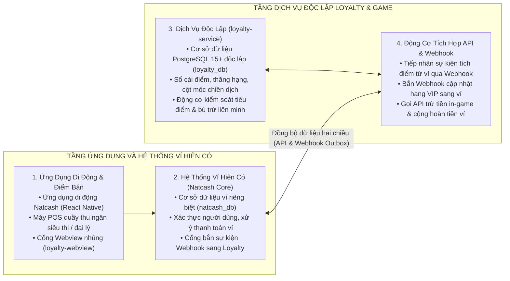
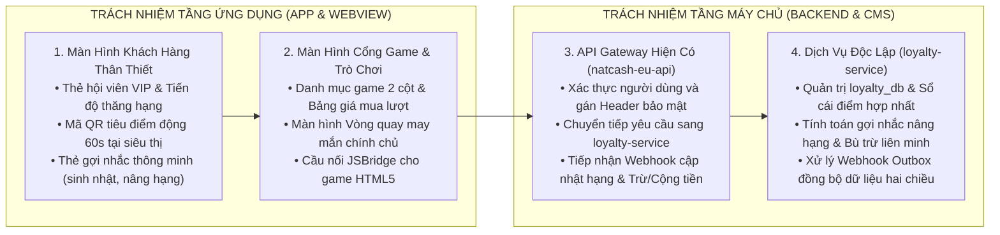
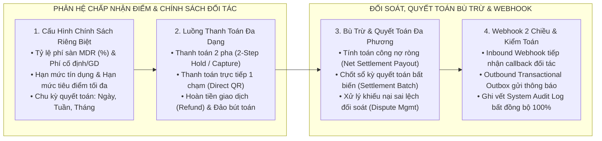
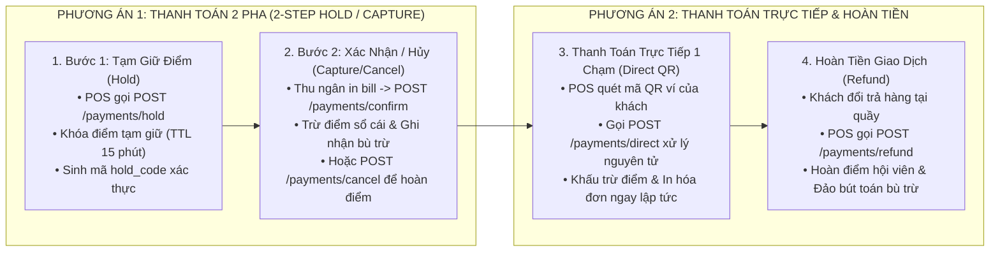
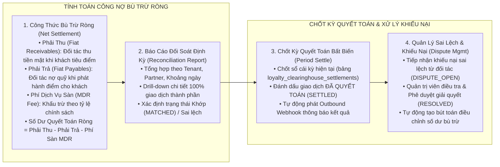
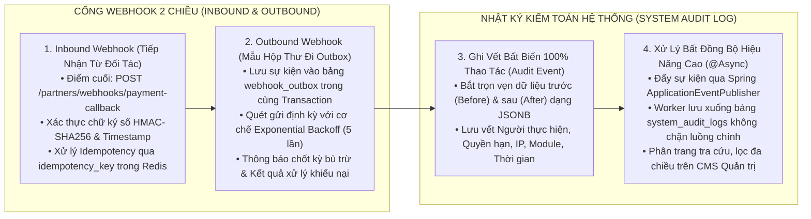
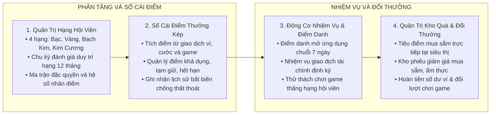
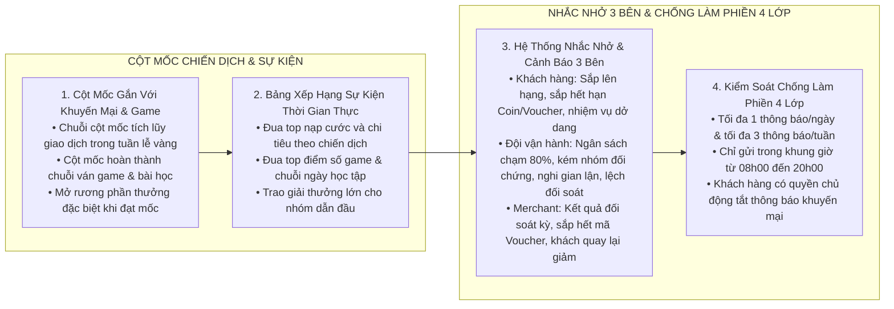
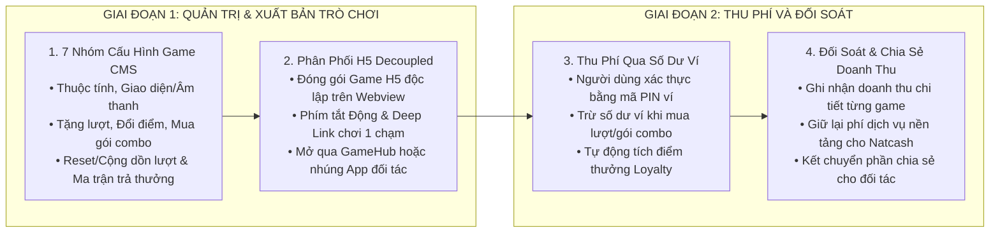

# TÀI LIỆU GIẢI PHÁP, NGHIỆP VỤ VÀ THIẾT KẾ TỔNG THỂ
## Nền Tảng Khách Hàng Thân Thiết Liên Minh và Cổng Game Đa Thuê Bao

> **Đơn vị xây dựng:** Nhóm Kiến trúc và Giải pháp Số — Natcash  
> **Loại tài liệu:** Tài liệu Giải pháp và Thiết kế Kiến trúc Tổng thể  
> **Định vị chiến lược:** Hệ thống Khách hàng thân thiết là giải pháp nền tảng liên minh đa đối tác bao trùm toàn bộ dịch vụ ví điện tử Natcash, mạng viễn thông Natcom và các đối tác liên kết thương mại. Cổng Game là phân hệ giải trí và trò chơi hóa trực thuộc, đóng vai trò gia tăng tương tác và tạo nguồn doanh thu dịch vụ mới.  
> **Phương án công nghệ chính thức:**  
> • Cơ sở dữ liệu quan hệ độc lập: **PostgreSQL 15+** (`loyalty_db` tách biệt 100% với `natcash_db`).  
> • Máy chủ nghiệp vụ độc lập: **Java 17 LTS / Spring Boot 2.7.14+** (`loyalty-service`).  
> • Khóa phân tán và Bộ nhớ đệm: **Redis 7.x Cluster** (Thư viện Redisson 3.20+).  
> • Truyền thông sự kiện và Đồng bộ: **Mẫu Hộp thư đi (Transactional Outbox Pattern)** kết hợp **Redis Streams**.  
> • Cổng Quản trị Trung tâm: **ReactJS 18+ / TypeScript / Vite / Ant Design 5.x** (`loyalty-cms` đóng gói tĩnh qua Nginx).  
> • Cổng Webview nhúng đối tác: **ReactJS 18+ / TypeScript / Vite / TailwindCSS Mobile-First** (`loyalty-webview` đóng gói tĩnh qua Nginx).  
> • Ứng dụng di động ví: **React Native** (`natcash-eu-app`).  
> • Cổng kết nối chuyển tiếp: **Java Spring Boot Reverse Proxy** (`natcash-eu-api`).

---

## 1. BỐI CẢNH, MỤC TIÊU CHIẾN LƯỢC VÀ CHỈ SỐ ĐO LƯỜNG

### 1.1. Bối Cảnh Thị Trường và Bài Toán Kinh Doanh
Trong thị trường thanh toán số và dịch vụ tiêu dùng cạnh tranh khốc liệt, các chương trình tích điểm đơn lẻ, khép kín của từng dịch vụ riêng biệt không còn đủ sức hấp dẫn người dùng. Khách hàng mong muốn một **Ví Phần Thưởng hợp nhất** có giá trị thực tế cao, có thể tích lũy từ mọi hoạt động chi tiêu hàng ngày (nạp cước điện thoại, thanh toán hóa đơn, mua sắm siêu thị, đổ xăng, chơi game) và tự do sử dụng số điểm, mã giảm giá đó để thanh toán trực tiếp hoặc đổi quà tại bất kỳ điểm chấp nhận nào trong toàn mạng lưới liên minh.

### 1.2. Mục Tiêu Chiến Lược Của Giải Pháp
1. **Liên thông Ví Phần Thưởng hợp nhất:** Tích hợp toàn diện thông tin Hạng hội viên, Điểm tích lũy, Mã giảm giá và Quà tặng thành một Ví Phần Thưởng chung duy nhất, cho phép các đối tác liên minh tra cứu và khấu trừ theo thời gian thực.
2. **Tiêu điểm và dùng quà như phương tiện thanh toán trực tiếp:** Cho phép người dùng sử dụng điểm tích lũy hoặc mã giảm giá trong Ví Phần Thưởng để trừ thẳng vào hóa đơn mua sắm hoặc đổi quà hiện vật tại quầy thu ngân của đối tác.
3. **Bộ máy kiểm soát điều kiện sử dụng linh hoạt:** Thiết lập cơ chế phân quyền, kiểm soát điều kiện chấp nhận đổi điểm theo từng đối tác, từng loại nguồn điểm, hạn mức giao dịch và hạng hội viên nhằm bảo vệ ngân sách và an toàn tài chính.
4. **Hệ thống thanh toán bù trừ tài chính tự động:** Tự động ghi nhận, đối soát và thanh toán bù trừ công nợ giữa đơn vị phát hành điểm và đơn vị chấp nhận tiêu điểm định kỳ.
5. **Động cơ cột mốc chiến dịch và gợi nhắc thông minh:** Xây dựng các chặng cột mốc nhiệm vụ gắn liền với các chiến dịch khuyến mại, sự kiện mùa vụ và giải đấu game; kết hợp cơ chế gợi nhắc tự động có kiểm soát tần suất nhằm chăm sóc khách hàng chu đáo mà không gây phiền toái.
6. **Trò chơi hóa và Cổng Game đa năng:** Đóng vai trò là phân hệ giải trí gia tăng gắn kết, tiêu thụ điểm thưởng và tạo dòng doanh thu chia sẻ với các nhà phát triển game lẻ.

### 1.3. Các Chỉ Số Đo Lường Hiệu Quả Cốt Lõi
* **Tỉ lệ giữ chân người dùng:** Tăng 30% – 40% tỉ lệ người dùng hoạt động hàng tháng và hàng ngày.
* **Tần suất chi tiêu qua mạng lưới liên minh:** Gia tăng 50% khối lượng giao dịch thanh toán chéo giữa viễn thông, ví điện tử và mạng lưới đối tác bán lẻ.
* **Tỉ lệ tương tác với thông điệp gợi nhắc:** Đạt trên 25% tỉ lệ người dùng thực hiện hành động sau khi nhận thông báo gợi nhắc nâng hạng hoặc tiêu điểm sắp hết hạn.
* **Tỉ lệ tiêu thụ điểm thưởng:** Đạt mức tối ưu 70% – 80%, khẳng định giá trị thanh khoản thực tế của điểm thưởng đối với người tiêu dùng.

---

## 2. KIẾN TRÚC GIẢI PHÁP TỔNG THỂ VÀ PHÂN TÁCH CƠ SỞ DỮ LIỆU

Hệ thống được thiết kế theo kiến trúc Microservices đa thuê bao, trong đó cơ sở dữ liệu của dịch vụ Khách hàng thân thiết (`loyalty_db` trên PostgreSQL 15+) được tách riêng biệt hoàn toàn với cơ sở dữ liệu của hệ thống ví lõi (`natcash_db`):

---

## 3. PHÂN ĐỊNH TRÁCH NHIỆM TÍCH HỢP GIỮA CÁC TẦNG HỆ THỐNG

Để tích hợp thành công giải pháp, các thành phần hệ thống cần thực hiện các trách nhiệm rõ ràng:

### 3.1. Trách Nhiệm Của Tầng Ứng Dụng Di Động (`natcash-eu-app`) và Webview Nhúng (`loyalty-webview`)
1. **Xây dựng Màn hình Trung tâm Loyalty:** Hiển thị thẻ hội viên VIP (Bạc, Vàng, Bạch Kim, Kim Cương), thanh tiến độ điểm xét hạng chu kỳ năm, danh sách nhiệm vụ điểm danh và các thẻ gợi nhắc thông minh.
2. **Tích hợp Màn hình Sinh mã QR Tiêu điểm tại quầy:** Sinh mã QR động có chữ ký bảo mật với thời hạn 60 giây để máy POS siêu thị quét tra cứu Ví Phần Thưởng và trừ điểm/dùng voucher trực tiếp trên hóa đơn.
3. **Nâng cấp Cổng Game & Trình chơi Webview tập trung:** Bổ sung bảng giá mua lượt chơi/vật phẩm, cửa sổ xác thực mã PIN ví và cầu nối JSBridge hỗ trợ game HTML5 gọi hàm thanh toán ví.
4. **Tích hợp Màn hình Vòng quay may mắn:** Nhúng component đĩa quay may mắn kèm âm thanh, kết nối API quay thưởng và hiển thị kết quả.

### 3.2. Trách Nhiệm Của Tầng API Gateway Hiện Có (`natcash-eu-api`)
1. **Đóng vai trò Cổng Chuyển tiếp Bảo mật (Reverse Proxy):** Nhận yêu cầu từ ứng dụng di động, giải mã JWT token người dùng, trích xuất `User ID` / `Phone` / `Tenant ID`, gắn các header bảo mật (`X-Tenant-Id`, `X-User-Id`, `X-Signature`) và chuyển tiếp sang `loyalty-service`.
2. **Đồng bộ hồ sơ người dùng:** Gọi `POST /loyalty/v1/sync/user-profile` khi có người dùng đăng ký ví mới hoặc cập nhật ngày sinh.
3. **Lắng nghe Webhook cập nhật Hạng hội viên:** Tiếp nhận Webhook `POST /wallet/v1/webhooks/loyalty-tier-update` để cập nhật quyền lợi miễn giảm phí giao dịch chuyển tiền và hiển thị huy hiệu VIP trên trang chủ ví.
4. **Cung cấp API Trừ tiền in-game & Hoàn tiền số dư ví:**
   * `POST /wallet/v1/debit-in-game`: Nhận yêu cầu từ Loyalty, kiểm tra số dư ví người dùng, trừ tiền ví và trả kết quả.
   * `POST /wallet/v1/credit-cashback`: Nhận yêu cầu từ Loyalty khi người dùng đổi điểm sang tiền mặt, cộng tiền vào số dư ví và lưu sổ cái tài chính.
5. **Cung cấp Kênh bắn thông báo đẩy:** Tiếp nhận thông báo từ Loyalty để đẩy tin nhắn qua Firebase Cloud Messaging / Apple APNs / SMS Brandname đến điện thoại người dùng.

### 3.3. Trách Nhiệm Của Hệ Thống Đối Tác Bán Lẻ và Nhà Phát Triển Game
* **Hệ thống POS Siêu thị / Cây xăng:** Tích hợp API liên thông Ví Phần Thưởng `POST /loyalty/v1/partners/reward-wallet/inquiry` để tra cứu hạng, điểm, mã giảm giá và gọi `POST /loyalty/v1/partners/reward-wallet/redeem` để trừ điểm, áp voucher hoặc đổi quà tại quầy.
* **Đối tác Phát triển Game:** Đóng gói game HTML5 tuân thủ chuẩn giao tiếp JSBridge để tiếp nhận mã phiên chơi (`session_id`) và gọi API thanh toán ví.

---

## 4. MÔ HÌNH CHẤP NHẬN ĐIỂM ĐỐI TÁC, LIÊN THÔNG VÍ PHẦN THƯỞNG VÀ BÙ TRỪ TÀI CHÍNH LIÊN MINH

Điểm đột phá của giải pháp là việc chuẩn hóa **Mô Hình Chấp Nhận Điểm Đối Tác (Partner Points Acceptance)** và **Ví Phần Thưởng Hợp Nhất (Reward Wallet)**, cho phép mọi đối tác trong liên minh liên thông dữ liệu, thực hiện giao dịch thanh toán trừ điểm đa phương thức, kiểm soát rủi ro tài chính và quyết toán bù trừ tự động:

### 4.1. Cấu Hình Chính Sách Chấp Nhận Điểm Riêng Biệt Cho Từng Đối Tác (Policy Engine)
Mỗi đối tác liên minh (Siêu thị Delimart, Cây xăng, Nhà thuốc, Chuỗi F&B, Cổng Game) khi tham gia mạng lưới đều được thiết lập một bộ quy tắc chính sách nghiệp vụ độc lập tại bảng `loyalty_acceptance_policies`:
1. **Tỷ lệ phí chiết khấu sàn (MDR Fee Percent):** Tỷ lệ phần trăm phí sàn mà đối tác chấp nhận chia sẻ trên giá trị điểm thanh toán (Ví dụ: Siêu thị Delimart chịu phí MDR `1.5%`).
2. **Phí xử lý cố định trên mỗi giao dịch (Fixed Fee Per Transaction):** Phí dịch vụ cố định thu trên mỗi lượt giao dịch (Ví dụ: `0.50 HTG/giao dịch`).
3. **Hạn mức công nợ tín dụng đối tác (Credit Limit Amount):** Ngưỡng hạn mức công nợ tối đa cho phép đối tác thanh toán tiêu điểm (Ví dụ: `50.000 HTG`). Hệ thống tự động từ chối giao dịch nếu vượt hạn mức để bảo vệ thanh khoản và an toàn tài chính.
4. **Hạn mức tiêu điểm tối đa trên từng giao dịch & theo ngày:** Giới hạn số điểm tối đa được phép trừ trong một đơn hàng (`max_burn_points_per_tx`) và trong một ngày (`daily_burn_limit`).
5. **Chu kỳ quyết toán bù trừ (Settlement Cycle):** Cấu hình linh hoạt theo từng đối tác: Hàng ngày (`DAILY`), Hàng tuần (`WEEKLY`) hoặc Hàng tháng (`MONTHLY`).
6. **Tỷ giá quy đổi điểm & Điều kiện hạng:** Quy định tỷ giá quy đổi (`redemption_rate`: 1 điểm = 1 HTG), danh mục nguồn điểm được phép tiêu (`allowed_point_types`) và hạng hội viên tối thiểu được áp dụng (`min_tier_level`).

---

### 4.2. Các Phương Thức Thanh Toán Điểm Chuẩn Hóa

#### 1. Thanh toán 2 pha (2-Step Hold / Capture Flow):
Phù hợp cho các hệ thống bán lẻ POS lớn, đơn hàng giao hàng tận nơi hoặc dịch vụ cần thời gian chuẩn bị đơn:
* **Bước 1 — Tạm giữ điểm (`POST /loyalty/v1/partners/payments/hold`):** Kiểm tra chính sách đối tác, kiểm tra số dư điểm và số dư tín dụng, khóa số điểm tương ứng vào trạng thái `HOLD` (bảng `loyalty_payment_holds`) với thời hạn 15 phút.
* **Bước 2 — Xác nhận thanh toán (`POST /loyalty/v1/partners/payments/confirm`):** Khi quầy POS in hóa đơn thành công, gọi lệnh Capture để chuyển trạng thái sang `CONFIRMED`, khấu trừ điểm chính thức trên sổ cái `loyalty_point_ledger`, ghi nhận giao dịch bù trừ `clearing_transactions`, tính phí MDR và giá trị quyết toán ròng.
* **Hủy tạm giữ (`POST /loyalty/v1/partners/payments/cancel`):** Nếu khách hàng hủy mua hoặc đơn hàng không thành công, giải phóng điểm bị tạm giữ về tài khoản khách hàng ngay lập tức.

#### 2. Thanh toán trực tiếp 1 chạm (1-Touch Direct Payment Flow):
Phù hợp cho quầy thanh toán nhanh tại siêu thị, cửa hàng tiện lợi và cây xăng:
* POS quét mã QR động của khách hàng và gọi `POST /loyalty/v1/partners/payments/direct`. Hệ thống thực hiện tạm giữ và xác nhận thanh toán nguyên tử trong cùng một giao dịch, trừ điểm và trả về kết quả thành công trong dưới 100ms.

#### 3. Hoàn tiền giao dịch (Refund Flow):
* Khi phát sinh đổi trả hàng hoặc hủy hóa đơn, POS gọi `POST /loyalty/v1/partners/payments/refund`. Hệ thống hoàn trả điểm thưởng vào tài khoản khách hàng và ghi nhận một bản ghi bù trừ đảo (`REFUND`) trong sổ cái đối soát.

---

### 4.3. Động Cơ Đối Soát, Quyết Toán Bù Trừ Đa Phương & Xử Lý Khiếu Nại (Clearinghouse & Disputes)

1. **Công thức tính toán bù trừ tài chính chuẩn:**
   * `Fiat Receivables (Khoản phải thu từ Quỹ Loyalty):` Tổng giá trị điểm mà đối tác đã chấp nhận cho khách hàng tiêu dùng để giảm trừ tiền mặt.
   * `Fiat Payables (Khoản phải trả về Quỹ Loyalty):` Tổng giá trị điểm mà đối tác đã phát hành/tặng cho khách hàng từ các đơn hàng.
   * `Total MDR Fee (Phí sàn dịch vụ):` Tổng phí chiết khấu sàn và phí cố định giữ lại cho đơn vị vận hành nền tảng.
   * `Net Settlement Amount (Số tiền quyết toán ròng) = Fiat Receivables - Fiat Payables - Total MDR Fee`.
     * Nếu `Net > 0`: Quỹ Loyalty chi trả (Payout) tiền mặt cho đối tác.
     * Nếu `Net < 0`: Đối tác thanh toán nộp bổ sung tiền mặt vào Quỹ Loyalty.

2. **Chốt kỳ quyết toán bất biến (Clearinghouse Period Settlement):**
   * Quản trị viên kích hoạt hoặc Cronjob định kỳ chạy `POST /loyalty/v1/clearing/settle-period`. Hệ thống chốt số liệu công nợ, lưu vào bảng `loyalty_clearinghouse_settlements`, đánh dấu `clearing_status = SETTLED` và phát Webhook thông báo cho đối tác.

3. **Quy trình xử lý khiếu nại sai lệch đối soát (Dispute Resolution Workflow):**
   * Khi phát hiện sai lệch số liệu trong kỳ đối soát, đối tác gửi yêu cầu khiếu nại qua API `POST /loyalty/v1/partners/clearing/disputes`.
   * Trạng thái khiếu nại chuyển từ `PENDING` → `UNDER_INVESTIGATION` → `RESOLVED` / `REJECTED`.
   * Khi Quản trị viên duyệt giải quyết khiếu nại (`POST /loyalty/v1/clearing/disputes/{disputeCode}/resolve`), hệ thống tự động sinh bút toán bù trừ điều chỉnh (`DISPUTE_ADJUSTMENT`), cập nhật sổ cái và phát Webhook kết quả sang đối tác.

---

### 4.4. Cổng Webhook 2 Chiều & Nhật Ký Kiểm Toán Tự Động (System Audit Log)

1. **Inbound Webhook (Tiếp nhận thông báo thanh toán/hạch toán từ đối tác):**
   * Điểm cuối `POST /loyalty/v1/partners/webhooks/payment-callback`.
   * Kiểm tra chữ ký số bảo mật `X-Loyalty-Signature` sử dụng mã bí mật `webhook_secret`.
   * Kiểm soát tính lũy kế (Idempotency) qua khóa `idempotency_key` lưu trên Redis TTL 24 giờ để đảm bảo không bị xử lý trùng lặp khi đối tác bắn lại bản tin.
   * Phản hồi `200 OK` tức thì và đẩy tiến trình hạch toán sang hàng đợi xử lý bất đồng bộ.

2. **Outbound Webhook (Bắn thông báo sang hệ thống đối tác):**
   * Sử dụng **Mẫu Hộp thư đi (Transactional Outbox Pattern)**: Ghi bản tin vào bảng `webhook_outbox` trong cùng Database Transaction với thay đổi nghiệp vụ để đảm bảo độ tin cậy tuyệt đối.
   * Tiến trình nền quét và bắn Webhook với cơ chế thử lại giãn cách lũy tiến theo cấp số nhân (1m → 5m → 30m → 2h → 6h). Sau 5 lần thất bại, sự kiện được chuyển vào `webhook_dead_letter` để giám sát trên CMS.

3. **Phân hệ Nhật Ký Kiểm Toán Tự Động (System Audit Log):**
   * Tự động ghi vết bất biến mọi thay đổi trọng yếu: Cập nhật chính sách đối tác, thay đổi tỷ lệ MDR, điều chỉnh hạn mức tín dụng, thăng/hạ hạng hội viên, chốt quyết toán bù trừ và duyệt giải quyết khiếu nại.
   * Lưu trữ trọn vẹn trạng thái trước (`before_data`) và sau (`after_data`) định dạng `JSONB` trong bảng `system_audit_logs` trên PostgreSQL 15+.
   * Thực thi bất đồng bộ 100% qua cấu hình `@Async` Thread Pool riêng (`AuditAsyncConfig`), triệt tiêu hoàn toàn độ trễ và không ảnh hưởng đến luồng giao dịch nghiệp vụ.

---

## 5. MÔ HÌNH NGHIỆP VỤ CHUYÊN SÂU KHÁCH HÀNG THÂN THIẾT

Hệ sinh thái Khách hàng thân thiết được cấu thành từ 4 trụ cột nghiệp vụ nền tảng:

### 5.1. Mô Hình Phân Tầng Hội Viên và Vòng Đời Khách Hàng
* **Tự động là hội viên:** Mọi khách hàng có Ví Natcash tự động là hội viên hạng `Silver` ngay từ đầu, không cần đăng ký riêng.
* **Cơ chế xét hạng 12 tháng nhân văn:**
  1. **Chu kỳ xét hạng:** 12 tháng theo năm dương lịch (`01/01` đến `31/12`), dựa trên **Điểm hạng (`TIER_POINT`)** tích lũy trong kỳ.
  2. **Đủ điểm là lên hạng ngay:** Khi đạt mốc điểm của hạng cao hơn, khách hàng được nâng hạng tức thì và giữ hạng mới hết kỳ kế tiếp.
  3. **Không hạ hạng giữa kỳ:** Tuyệt đối không hạ hạng hội viên khi đang trong năm xét hạng.
  4. **Báo trước 30 ngày & Hạ tối đa 1 hạng:** Gửi thông báo nhắc khách hàng trước 30 ngày khi sắp hết kỳ; cuối kỳ nếu không đủ điểm duy trì thì chỉ hạ tối đa **1 bậc hạng**.
* **Ma trận phân cấp 4 hạng & Hệ số nhân `Natcash Coin`:**

| Hạng hội viên | Điểm hạng tối thiểu / năm | Hệ số nhân `Natcash Coin` | Đặc quyền nổi bật |
| :--- | :--- | :---: | :--- |
| **Silver (Bạc)** | `0` điểm | `× 1.0` | Tích điểm cơ bản mọi giao dịch; tham gia nhiệm vụ hàng ngày; đổi Voucher và gói Data tiêu chuẩn. |
| **Gold (Vàng)** | `1.000` điểm | `× 1.1` (`+10%`) | Cộng thêm 10% `Natcash Coin` mọi giao dịch; mở kho quà hạng Gold; quà tặng mừng sinh nhật. |
| **Platinum (Bạch Kim)** | `5.000` điểm | `× 1.25` (`+25%`) | Cộng thêm 25% `Natcash Coin`; mở kho quà độc quyền Platinum; ưu tiên tổng đài hỗ trợ. |
| **Diamond (Kim Cương)** | `15.000` điểm | `× 1.5` (`+50%`) | Cộng thêm 50% `Natcash Coin`; kho quà VIP giới hạn; chăm sóc ưu tiên đặc biệt toàn liên minh. |

---

### 5.2. Tách Bạch Hai Đơn Vị Thưởng: Điểm Hạng & Natcash Coin
* **Tách rõ 2 đơn vị tránh nhầm lẫn:**
  1. **Điểm hạng (`TIER_POINT`):** Dùng để xác định hạng hội viên (`Silver → Gold → Platinum → Diamond`), **không bị trừ khi khách hàng đổi quà** và được đặt lại theo chu kỳ xét hạng 12 tháng.
  2. **`Natcash Coin` (`LOYALTY_COIN`):** Đơn vị thưởng dùng để tiêu và đổi quà với tỷ giá neo cố định **`1 Coin = 1 HTG`**. Dùng để đổi Voucher, đổi gói Data/Phút gọi viễn thông hoặc trừ trực tiếp vào hóa đơn tại Merchant liên minh. Có hạn dùng theo lô (`FIFO`) và nhắc trước khi hết hạn.
* **Quy tắc tích lũy đa kênh:**
  1. *Thanh toán hóa đơn, nạp tiền, chuyển tiền và mua sắm ví:* Tích lũy đồng thời Điểm hạng và `Natcash Coin` (nhân hệ số hạng `×1.0` đến `×1.5`).
  2. *Nạp cước viễn thông và mua gói Data:* Tích lũy theo giá trị giao dịch viễn thông.
  3. *Hoàn thành nhiệm vụ, cột mốc, trò chơi và bài học ngắn:* Nhận `Natcash Coin`, Voucher, gói Data hoặc lượt chơi.

---

### 5.3. Động Cơ Nhiệm Vụ Động 9 Nhóm (`KHI – NẾU – THÌ – GIỚI HẠN`)
Hệ thống cung cấp bộ khung cấu hình nhiệm vụ động không cần sửa mã nguồn (`KHI sự kiện xảy ra` → `NẾU thỏa điều kiện` → `THÌ trao thưởng` → `GIỚI HẠN ngân sách & tần suất`), bao phủ 9 nhóm nhiệm vụ:
1. **Chào mừng (`Onboarding`):** Mở ví, định danh `eKYC`, giao dịch đầu tiên.
2. **Hằng ngày (`Daily`):** Điểm danh mở ứng dụng, thanh toán QR, nạp tiền điện thoại.
3. **Chuỗi ngày (`Streak`):** Duy trì hành động 3 ngày, 7 ngày, 14 ngày, 30 ngày liên tiếp.
4. **Theo tuần / tháng:** Hoàn thành các mốc tích lũy giao dịch trong tuần hoặc tháng.
5. **Theo dịch vụ:** Thanh toán hóa đơn Điện/Nước, nạp Data 4G, chuyển tiền ví.
6. **Tại Merchant liên minh:** Mua sắm tại siêu thị `Delimart`, nhà hàng, hiệu thuốc liên minh.
7. **Giới thiệu bạn bè (`Referral`):** Mời bạn mới mở ví và phát sinh giao dịch thực.
8. **Kích hoạt lại (`Re-activation`):** Nhiệm vụ kéo khách hàng lâu ngày chưa giao dịch quay lại.
9. **Nhiệm vụ cho `Agent` & `Super Agent`:** Chăm sóc đủ 100 khách hàng/tháng đối với `Agent` và đạt từ 50% chỉ tiêu mạng lưới đối với `Super Agent`.

---

### 5.4. Kho Quà Tặng và Động Cơ Đổi Thưởng Đa Năng
Hệ thống cung cấp 4 hình thức đổi thưởng linh hoạt bằng `Natcash Coin` (`1 Coin = 1 HTG`):
1. **Trừ trực tiếp vào hóa đơn tại Merchant liên minh:** Quét mã QR giảm tiền trực tiếp tại quầy thu ngân siêu thị, cửa hàng đối tác.
2. **Đổi gói Data (GB) & Phút gọi viễn thông:** Cấp phát tức thời qua kết nối trực tiếp với hệ thống `Natcom BCCS`.
3. **Phiếu giảm giá điện tử (`Voucher`):** Đổi mã ưu đãi mua sắm, ẩm thực, dịch vụ từ mạng lưới đối tác liên minh.
4. **Học tập & Giải trí trên GameHub:** Nhận lượt tham gia các trò chơi giải trí, trí tuệ và các khóa học ngắn đổi thưởng.

---

## 6. ĐỘNG CƠ CỘT MỐC, NHẮC NHỞ 3 BÊN VÀ CHỐNG LÀM PHIỀN 4 LỚP

Để duy trì sự hiện diện liên tục trong tâm trí khách hàng và hỗ trợ vận hành chủ động mà không gây phiền hà, hệ thống thiết lập cơ chế nhắc nhở 3 bên kết hợp bộ lọc chống làm phiền 4 lớp:

### 6.1. Chuỗi Cột Mốc và Nhiệm Vụ Động Theo Sự Kiện
* **Cột mốc theo chiến dịch khuyến mại:** Người dùng tham gia các chiến dịch tuần lễ vàng (Nạp cước viễn thông ngày vàng, Ngày hội mua sắm không tiền mặt). Khi đạt từng mốc giao dịch (Mốc 1: 3 giao dịch → Mốc 2: 5 giao dịch → Mốc 3: 10 giao dịch), hệ thống tự động mở khóa các phần quà tăng dần.
* **Cột mốc gắn với Cổng Game & Học tập:** Tổ chức các giải đấu mùa vụ và thử thách học tập hàng ngày trên GameHub. Khách hàng vượt qua các màn chơi hoặc hoàn thành chuỗi bài học ngắn sẽ nhận huy hiệu vinh danh và thưởng `Natcash Coin`.

### 6.2. Hệ Thống Nhắc Nhở & Cảnh Báo Tự Động Cho 3 Bên
1. **Nhắc nhở cho Khách hàng:**
   * Sắp đủ điểm lên hạng hoặc cần tích thêm trước kỳ xét hạng cuối năm (báo trước 30 ngày).
   * `Natcash Coin` hoặc `Voucher` sắp hết hạn sử dụng.
   * Nhiệm vụ đang làm dở và ưu đãi phù hợp theo hành vi thực tế.
2. **Cảnh báo cho Đội vận hành Natcash:**
   * Chiến dịch chạm ngưỡng **80% ngân sách**.
   * Chiến dịch có hiệu quả **kém hơn nhóm đối chứng (`Control Group`)**.
   * Phát hiện dấu hiệu **nghi gian lận (`Fraud Anomaly`)** hoặc **lệch số liệu đối soát**.
3. **Thông báo cho Đối tác (`Merchant`):**
   * Thông báo kết quả đối soát và quyết toán cuối kỳ.
   * Cảnh báo kho `Voucher` của đối tác sắp hết số lượng.
   * Cảnh báo lượng khách hàng quay lại chi nhánh sụt giảm bất thường.

### 6.3. Cơ Chế Kiểm Soát Chống Làm Phiền 4 Lớp
1. **Giới hạn theo ngày:** Tối đa **1 thông báo đẩy / ngày** cho mỗi khách hàng.
2. **Giới hạn theo tuần:** Tối đa **3 thông báo đẩy / tuần** cho mỗi khách hàng.
3. **Giới hạn khung giờ:** Chỉ gửi thông báo từ **08h00 sáng đến 20h00 tối** (tuyệt đối không gửi ban đêm).
4. **Quyền chủ động của khách hàng (`Opt-out`):** Khách hàng có nút bật/tắt nhận thông báo nhắc nhở khuyến mại ngay trên ứng dụng; các gợi nhắc thông thường được ưu tiên hiển thị nhẹ nhàng dưới dạng thẻ thông tin trên màn hình Loyalty.

## 7. MÔ HÌNH NGHIỆP VỤ CỔNG GAME VÀ KINH TẾ TRÒ CHƠI

Cổng Game (GameHub) là phân hệ giải trí, giữ chân khách hàng và trò chơi hóa (Gamification) độc lập trực thuộc hệ sinh thái Khách hàng thân thiết:

### 7.1. Phân Loại 2 Chiều Cổng GameHub & Học Tập Đổi Thưởng (`EdTech / Micro-Learning`)
* **Phân loại 2 chiều trên một cổng dùng chung:**
  1. **Theo nội dung (3 nhóm):**
     * **Giải trí (`ENTERTAINMENT`):** Vòng quay may mắn, Đập lu vàng, Cào thẻ, Hứng xu.
     * **Trí tuệ (`PUZZLE_BRAIN`):** Đố vui kiến thức, Ghép hình, Giải ô chữ, Thử thách trí nhớ.
     * **Giáo dục & Học tập (`EDUCATION_LEARNING`):** Các khóa học ngắn 3–5 phút mỗi ngày giúp người dùng học ngoại ngữ và kỹ năng tài chính để nhận thưởng:
       * `English Daily`: Học tiếng Anh giao tiếp hàng ngày.
       * `Spanish Start`: Học tiếng Tây Ban Nha cơ bản.
       * `Aprann Li`: Chương trình xóa mù chữ / đọc viết tiếng Creole bản địa.
       * `Money Smart`: Kiến thức quản lý tài chính cá nhân và an toàn ví điện tử.
  2. **Theo mô hình kinh tế (2 nhóm):**
     * **Miễn phí (`FREE_TO_PLAY`):** Người dùng nhận lượt chơi từ điểm danh, hoàn thành nhiệm vụ ví hoặc hoàn thành bài học hàng ngày.
     * **Thu phí đối tác (`PARTNER_MONETIZED`):** Dịch vụ trò chơi/học tập nâng cao của nhà phát triển đối tác tích hợp qua SDK/API và chia sẻ doanh thu; **hệ thống Loyalty cốt lõi của Natcash tuyệt đối không bán lượt chơi bằng tiền mặt và không trả thưởng bằng tiền mặt** để loại bỏ hoàn toàn rủi ro pháp lý về trò chơi có thưởng ăn tiền.
* **6 lớp kỹ thuật dùng chung của GameHub:** Toàn bộ game nội bộ và game đối tác dùng chung 6 lớp: `Danh mục game`, `Cấp lượt chơi`, ` Bảng xếp hạng`, `Trao thưởng`, `Chống gian lận` và `Báo cáo hiệu quả`.

### 7.2. Kiến Trúc Tách Rời Webview Độc Lập & Game H5 Decoupled
* **Không làm trực tiếp vào mã nguồn ứng dụng ví Natcash:** Toàn bộ giao diện Frontend của Trung tâm Loyalty, Cổng GameHub và các trò chơi H5 được đặt trọn vẹn trong module độc lập `loyalty-webview` và các gói tĩnh H5 riêng biệt.
* **Cơ chế nhúng đa đối tác (Decoupled Embedding):** Ứng dụng ví Natcash hoặc bất kỳ ứng dụng đối tác liên minh nào (Siêu thị Delimart, Cây xăng, Ngân hàng, Viễn thông) chỉ cần tích hợp khung Webview cơ bản, truyền định danh đối tác `tenant_id`, vé phiên `session_ticket` và tương tác qua cầu nối hai chiều `LoyaltyJSBridge`.
* **Khả năng thay đổi nhận diện thương hiệu tức thì:** Khi mở Webview với tham số `theme`, toàn bộ hệ thống màu sắc, biểu tượng, đơn vị tiền tệ và danh mục voucher tự động biến đổi phù hợp với từng đối tác mà không cần biên dịch lại mã nguồn.

### 7.3. Các Phương Thức Tích Hợp Linh Hoạt Đa Kênh
Hệ thống hỗ trợ 4 phương thức tích hợp tối ưu theo từng nhu cầu trải nghiệm:
1. **Phương thức 1: Mở qua Cổng GameHub Tập Trung (GameHub Portal):** Người dùng truy cập Cổng GameHub để xem toàn bộ danh mục game theo thể loại (Giải trí, Trí tuệ, Giáo dục), kho lượt chơi cá nhân và bảng xếp hạng sự kiện.
2. **Phương thức 2: Mở Trực Tiếp Cổng GameHub Độc Lập (Không qua Loyalty):** GameHub hoạt động như một dịch vụ giải trí và học tập độc lập ngay trên màn hình trang chủ App.
3. **Phương thức 3: Chơi Ngay Qua Phím Tắt Động / Liên Kết Sâu (Direct Game Shortcut):** Người dùng chạm vào các icon/banner/widget game động trên trang chủ ví Natcash (ví dụ liên kết sâu `natcash://game/lucky-wheel`), hệ thống mở ngay trình chơi game H5 trong tích tắc.
4. **Phương thức 4: Nhúng Webview & Tích Hợp 1 Lần Qua SDK/API Cho Đối Tác:** Nhà phát triển game/ứng dụng học tập bên thứ ba tích hợp 1 lần qua bộ SDK/API chuẩn để phát hành trên GameHub.

### 7.4. Tiêu Chuẩn 7 Nhóm Cấu Hình Game Chuẩn Công Nghiệp Phát Hành Trên CMS
Toàn bộ trò chơi và khóa học phát hành trên hệ thống được cấu hình tập trung trên `loyalty-cms` theo 7 nhóm thông số chuẩn:
1. **Nhóm 1: Thuộc tính & Siêu dữ liệu cơ bản:** Mã game, tên đa ngôn ngữ, phân loại 2 chiều (`Giải trí / Trí tuệ / Giáo dục` × `Miễn phí / Thu phí đối tác`), ảnh icon 1:1, ảnh banner 16:9, URL gói H5 bundle, trạng thái phát hành và thời gian hiệu lực.
2. **Nhóm 2: Cấu hình thành phần giao diện & âm thanh:** Bộ skin/theme theo mùa, số ô đĩa quay, hình ảnh giải thưởng, nhạc nền BGM, âm thanh hiệu ứng.
3. **Nhóm 3: Chính sách tặng lượt chơi miễn phí:** Tặng khi mở tài khoản/đăng ký mới, tặng khi điểm danh hàng ngày, tặng theo hạng hội viên (`Silver → Diamond`), tặng khi hoàn thành nhiệm vụ ví hoặc bài học.
4. **Nhóm 4: Chính sách quy đổi lượt chơi:** Bật/tắt quy đổi lượt, giới hạn số lượt tối đa mỗi ngày / mỗi tuần trên từng tài khoản và hạn mức toàn hệ thống.
5. **Nhóm 5: Chính sách gói dịch vụ đối tác (`Partner Monetized`):** Cấu hình gói học tập/trò chơi của đối tác nội dung và tỷ lệ đối soát chia sẻ doanh thu (tuân thủ nguyên tắc Loyalty không trực tiếp bán lượt chơi lấy tiền mặt).
6. **Nhóm 6: Chính sách vòng đời & hết hạn lượt chơi:** Cơ chế **Cộng dồn (`Roll-over`)** và **Làm mới về 0 (`Daily Reset`)** vào `23:59:59` cho lượt tặng miễn phí trong ngày.
7. **Nhóm 7: Chính sách trả thưởng & Ma trận xác suất:** Danh mục giải thưởng (`Natcash Coin`, Điểm hạng, `Voucher`, Gói Data/Phút gọi, Lượt chơi thêm), ma trận xác suất trúng thưởng (%) tổng 100%, hạn mức ngân sách trong ngày, lệnh nguyên tử trừ ngân sách Redis `DECRBY` và luật tự động lái xác suất khi hết hạn ngạch.

---

## 8. PHÂN HỆ ĐẠI LÝ (`AGENT & SUPER AGENT`), CỔNG MERCHANT ĐA CHI NHÁNH VÀ TRỢ LÝ AI

Để hoàn thiện trọn vẹn 11 phân hệ trên một nền tảng theo thiết kế tổng thể (chi tiết kỹ thuật xem tại [architecture_evolution_v2.md](architecture_evolution_v2.md)), hệ thống bổ sung 3 năng lực chiến lược:

### 8.1. Phân Hệ Đại Lý & Tổng Đại Lý (`Agent & Super Agent Loyalty`)
* **Nhiệm vụ và thưởng cho `Agent`:** Khuyến khích `Agent` mở mới khách hàng, hướng dẫn `eKYC` và hỗ trợ nạp/rút/thanh toán. Khi đạt mốc **Chăm sóc thành công 100 khách/tháng**, hệ thống tự động thưởng `Voucher`, gói `Data (GB)` qua `Natcom BCCS` hoặc thưởng hoa hồng tiền mặt vào ví đại lý đối với các nhiệm vụ phát triển mạng lưới đặc thù.
* **Đánh giá chỉ tiêu mạng lưới & Kịch bản hỗ trợ cho `Super Agent`:** Theo dõi tỷ lệ hoàn thành chỉ tiêu tổng hợp của toàn bộ các `Agent` cấp dưới trực thuộc:
  * **Đạt từ `50%` chỉ tiêu mạng lưới trở lên:** `Super Agent` đủ điều kiện nhận thưởng doanh số mạng lưới cuối kỳ.
  * **Dưới ngưỡng `50%` chỉ tiêu mạng lưới:** Hệ thống tự động kích hoạt **Kịch bản hỗ trợ (`Support Playbook`)**, cảnh báo cho Quản lý khu vực để hỗ trợ điểm bán kịp thời.

### 8.2. Cổng Đối Tác Thương Mại Tự Phục Vụ Đa Chi Nhánh (`Merchant Partner Portal`)
Cung cấp cổng làm việc riêng cho các chuỗi đối tác lớn (như siêu thị `Delimart`) với 6 chức năng tự phục vụ:
1. **Tổng quan hiệu quả (`Overview`):** Theo dõi khách hàng quay lại, doanh thu từ hội viên và số `Natcash Coin` đã tích/tiêu.
2. **Báo cáo chi tiết theo từng chi nhánh (`Branches`):** Xem số liệu tách biệt cho từng cửa hàng (ví dụ: `Pétion-Ville`, `Delmas 33`, `Cap-Haïtien`).
3. **Báo cáo theo nhóm ngành hàng (`Product Groups`):** Phân tích hiệu quả theo từng danh mục sản phẩm.
4. **Đề xuất chương trình tại điểm bán (`Propose an in-store program`):** Đối tác chủ động gửi đề xuất ưu đãi tại quầy kèm mức đồng tài trợ và trần ngân sách tháng để Đội vận hành Natcash phê duyệt.
5. **Quản lý ngân sách thưởng tháng & Bán chéo liên minh (`Monthly reward budget` & `Alliance cross-sell`).**
6. **Quản lý tài khoản nhân viên (`Staff accounts`):** Phân quyền cho Quản lý chi nhánh và Thu ngân quầy POS.

### 8.3. Đo Lường Bằng Nhóm Đối Chứng (`Control Group`) & Trợ Lý AI (`AI Campaign Copilot`)
* **Đo lường hiệu quả thực bằng Nhóm đối chứng (`Control Group`):** Mỗi chiến dịch tự động tách một tỷ lệ khách hàng tương đồng (mặc định `5% – 10%`) vào nhóm đối chứng không nhận ưu đãi để tính chính xác **Doanh thu tăng thêm thực chất (`True Net Uplift GMV`)**.
* **Trợ lý AI hỗ trợ Đội vận hành (`AI Campaign Copilot`):**
  1. **Gợi ý chương trình từ mục tiêu & ngân sách:** Nhập mục tiêu ngôn ngữ tự nhiên (ví dụ: *"Giữ chân khách nạp tiền tháng này, ngân sách 5.000 USD"*), AI tự động gợi ý nhóm khách hàng mục tiêu, cấu hình nhiệm vụ và mức thưởng.
  2. **Dự báo chi phí & tỷ lệ tham gia** trước khi bấm chạy.
  3. **Cảnh báo trùng lặp nhiệm vụ (`Conflict Detection`):** Tự động rà soát và cảnh báo nếu nhiệm vụ dự kiến bị trùng tập khách hàng và hành vi với một nhiệm vụ khác đang chạy.
  4. **Đánh dấu giao dịch nghi gian lận** để kiểm tra trước khi chi thưởng.
  5. **Nguyên tắc kiểm soát:** *AI chỉ gợi ý; con người duyệt và chịu trách nhiệm cuối cùng.*

---

## 9. CHIẾN LƯỢC KẾT NỐI 6 HỆ THỐNG NATCASH VÀ LỘ TRÌNH TRIỂN KHAI

### 9.1. Kiến Trúc Kết Nối 6 Hệ Thống Hiện Hữu Của Natcash
Nền tảng `loyalty-service` kết nối đồng bộ và bất đồng bộ với đầy đủ 6 hệ thống trong hạ tầng Natcash / Natcom:
1. **Core Ví (`Natcash Core Wallet`):** Đẩy sự kiện giao dịch bất đồng bộ sang Loyalty. **Quá trình tích điểm nằm hoàn toàn ngoài luồng giao dịch chính**, đảm bảo nếu Loyalty bảo trì thì giao dịch Ví vẫn thông suốt 100%.
2. **Mobile Service (`natcash-eu-app` & `natcash-eu-api`):** Hiển thị Trung tâm Loyalty, Mã QR Ví Phần Thưởng động 60 giây, Cổng GameHub và Phím tắt Động.
3. **Cổng tích hợp `WSO2 API Manager`:** Định tuyến, kiểm soát lưu lượng và bảo mật tập trung cho các luồng gọi API nội bộ và đối tác.
4. **Hệ thống viễn thông `Natcom BCCS`:** Gạch nối trực tiếp để cộng gói `Data (GB)`, phút gọi hoặc cước viễn thông tức thời ngay khi khách hàng hoặc `Agent` đổi thưởng.
5. **Cổng `USSD *202#`:** Phục vụ khách hàng dùng điện thoại phổ thông (`Feature Phone`) hoặc không có kết nối Internet tra cứu số dư `Natcash Coin`, kiểm tra hạng và đổi gói Data/Voucher qua menu `*202#`.
6. **Cổng `API Đối tác` & Máy POS:** Kết nối hệ thống thu ngân siêu thị và `Merchant Partner Portal` bằng xác thực Khóa kép (`X-Api-Key` + chữ ký `HMAC-SHA256`).

### 9.2. Lộ Trình Triển Khai 5 Giai Đoạn Cốt Lõi & Mở Rộng V2.0
1. **Giai đoạn 1: Hạ Tầng Kế Thừa, Cơ Sở Dữ Liệu PostgreSQL 15+ & Bảo Mật B2B:**
   - Tích hợp 11 module thư viện lõi `ims-libraries`, PostgreSQL 15+ độc lập `loyalty_db`, bộ lọc đa thuê bao `TenantContextFilter`, bảo mật Khóa kép HMAC-SHA256, khóa phân tán Redisson RLock, Redis Streams và Transactional Outbox Engine.
2. **Giai đoạn 2: Phát Triển 11 Phân Hệ Nghiệp Vụ, CMS, Partner Portal & Webview Độc Lập:**
   - Hoàn thiện mô hình 2 đơn vị (`Điểm hạng` & `Natcash Coin` `1 Coin = 1 HTG`), phân hạng 4 cấp (`Silver → Diamond`), động cơ nhiệm vụ động 9 nhóm, liên thông Ví Phần Thưởng và đối soát bù trừ liên minh.
   - Xây dựng Cổng GameHub 3 nhóm (*Giải trí, Trí tuệ, Giáo dục*), phân hệ `Agent & Super Agent`, `Merchant Partner Portal` đa chi nhánh và `AI Campaign Copilot`.
3. **Giai đoạn 3: Tích Hợp 6 Hệ Thống (`Core Ví`, `Mobile`, `WSO2`, `Natcom BCCS`, `USSD *202#`, `API Đối tác`):**
   - Nâng cấp Reverse Proxy Gateway `natcash-eu-api`, tích hợp `WSO2`, `Natcom BCCS` (trả thưởng Data/Phút gọi) và cổng `USSD *202#`.
   - Nâng cấp `natcash-eu-app`: Trung tâm Loyalty, Mã QR Ví Phần Thưởng động 60s, Cổng GameHub độc lập và Phím tắt Động.
4. **Giai đoạn 4: Kiểm Thử Tải Lớn, An Ninh & Triển Khai Production:**
   - Kiểm thử tải 1.000 RPS API điểm bán POS, kiểm thử tải đồng thời Vòng quay may mắn & ngân sách Redis `DECRBY`, Pentest bảo mật, đóng gói CI/CD và chạy thử nghiệm Pilot tại Siêu thị Delimart.
5. **Giai đoạn 5: Hệ Sinh Thái Giả Lập, Thử Nghiệm Sandbox & Chuyển Giao Đối Tác:**
   - Xây dựng Web POS Live Simulator cho quầy thu ngân siêu thị, App Đối tác Giả lập nhúng Webview qua SSO Ticket & JSBridge, Trình Giả lập Smartphone Live trên Webview và Cổng Developer Sandbox Portal soi chữ ký HMAC-SHA256.

