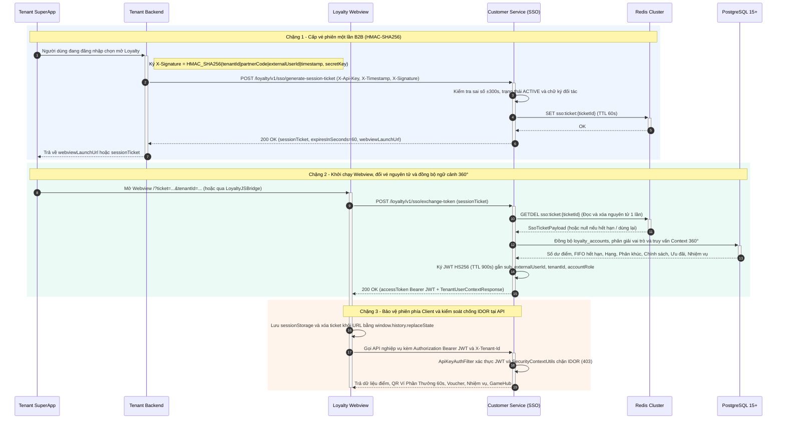

# TÀI LIỆU KỸ THUẬT: CƠ CHẾ XÁC THỰC TÀI KHOẢN ĐA THUÊ BAO VÀ HƯỚNG DẪN TÍCH HỢP CHO TENANT

---

## 1. TỔNG QUAN KIẾN TRÚC ĐỊNH DANH VÀ LIÊN THÔNG ĐA THUÊ BAO

Tài liệu này mô tả hoàn chỉnh cơ chế định danh, xác thực tài khoản người dùng đa thuê bao và quy trình tích hợp kỹ thuật dành cho các đơn vị thuê bao (Tenant như Ví Natcash, Siêu thị Delimart, Micro-CRM) khi kết nối ứng dụng hoặc cổng dịch vụ của mình vào hệ sinh thái `micro-loyalty`.

### 1.1. Nguyên Tắc Phân Lập Dữ Liệu Và Ánh Xạ Danh Tính
* **Cô lập dữ liệu theo `tenantId`:** Toàn bộ dữ liệu tài khoản hội viên (`loyalty_accounts`), chương trình đại lý (`loyalty_agent_programs`), sổ cái điểm (`loyalty_point_ledger`), hạng hội viên (`loyalty_tiers`), phân khúc khách hàng, chính sách tiêu điểm (`loyalty_acceptance_policies`), kho voucher (`loyalty_vouchers`) và cột mốc nhiệm vụ đều được gắn chặt theo cột `tenant_id` trên cơ sở dữ liệu `loyalty_db` (`PostgreSQL 15+`).
* **Ánh xạ danh tính liên thông (`externalUserId`):** Tenant giữ toàn quyền quản lý đăng nhập lõi, mật khẩu, mã PIN ví điện tử và dữ liệu eKYC ở phía hệ thống nguồn. Nền tảng Loyalty không lưu mật khẩu người dùng mà ánh xạ người dùng đã được xác thực của Tenant thông qua cặp khóa duy nhất `(tenant_id, external_user_id)` kết hợp số điện thoại (`phone_number`).
* **Đồng bộ vai trò đối tượng (`accountRole`):** Ngay tại thời điểm xác thực liên thông, hệ thống tự động đối soát vai trò của tài khoản giữa `CUSTOMER`, `AGENT` và `SUPER_AGENT` (dựa trên bảng `loyalty_agent_programs` và dữ liệu định danh Tenant gửi sang) để trả về đúng chính sách, ưu đãi và nhiệm vụ phù hợp.

### 1.2. Sơ Đồ Tuần Tự Luồng Xác Thực Liên Thông SSO Đa Thuê Bao



### 1.3. Phân Loại 3 Phương Thức Xác Thực Được Hỗ Trợ

| Phương thức | Cơ chế thực hiện | Ngữ cảnh áp dụng | Mức độ tin cậy |
| :--- | :--- | :--- | :--- |
| **Luồng 1: Vé Phiên Một Lần B2B** (`Single-Use Session Ticket`) | Tenant Backend ký số `HMAC-SHA256` xin vé `sessionTicket` qua API, mở Webview kèm `?ticket=...&tenantId=...` để đổi JWT HS256 và xóa vé nguyên tử trên Redis | Khuyến nghị mặc định cho SuperApp trên môi trường Production (Natcash App, Delimart App) | Rất cao — `secretKey` không bao giờ rời khỏi máy chủ Tenant |
| **Luồng 2: Cầu Nối Native & Khẳng Định Danh Tính** (`LoyaltyJSBridge` / `HMAC_ASSERTION` / `TENANT_TOKEN`) | SuperApp tiêm phiên qua `window.__LOYALTY_HOST_SESSION__` hoặc sự kiện `getUserSession` / `onNativeSession`, hoặc gửi token đối chiếu qua `IDENTITY_PROVIDER` | Ứng dụng React Native nhúng Webview cần đổi tài khoản động trong phiên hoặc tích hợp trực tiếp IdP riêng của Tenant | Cao — xác thực HMAC-SHA256 hoặc đối chiếu trực tiếp IdP của Tenant |
| **Luồng 3: Cổng Xác Thực Độc Lập Trên Webview** (`TenantAuthGate`) | Chặn 100% truy cập dữ liệu chưa định danh trên trình duyệt và yêu cầu đăng nhập định danh theo Tenant (`OTP_PIN` hoặc nhập vé `SSO`) | Người dùng truy cập Web Portal độc lập trên trình duyệt hoặc kiểm thử tích hợp UAT / Sandbox | Kiểm soát truy cập đầy đủ qua JWT HS256 và `SecurityContextUtils` |

---

## 2. QUY TRÌNH 4 BƯỚC TÍCH HỢP DÀNH CHO TENANT

Để đưa trải nghiệm Loyalty (điểm/coin, phân hạng, mã QR Ví Phần Thưởng 60 giây, kho ưu đãi, nhiệm vụ và GameHub) vào ứng dụng của Tenant, đội ngũ kỹ thuật của Tenant thực hiện theo 4 bước sau:

### Bước 1: Đăng Ký Thuê Bao, Cặp Khóa B2B Và Nhà Cung Cấp Định Danh
1. Quản trị hệ thống khởi tạo mã thuê bao `tenant_id` (ví dụ: `TENANT_NATCASH`) trong bảng `tenants` và tạo bản ghi đối tác đại diện trong bảng `loyalty_partners`:
   * `partner_code`: Mã định danh ứng dụng/kênh của Tenant (ví dụ: `NATCASH_WALLET`).
   * `api_key`: Khóa công khai dùng trong header `X-Api-Key`.
   * `secret_key`: Khóa bí mật dùng để ký số `HMAC-SHA256` ở phía Backend của Tenant.
   * `status`: `ACTIVE`.
2. Nếu Tenant áp dụng mô hình tự gửi token phiên riêng sang Loyalty (`TENANT_TOKEN` hoặc `NATIVE_BRIDGE`) và muốn Loyalty xác minh ngược với cơ chế của nhà cung cấp định danh, cấu hình thêm 1 bản ghi trong bảng `loyalty_tenant_integrations` với `integration_type = IDENTITY_PROVIDER`:
   * Hỗ trợ 3 chế độ `auth_type`:
     * `HMAC_SHA256`: Cấu hình `auth_credentials = {"secretKey": "<khóa_bí_mật_idp>"}`.
     * `BEARER_TOKEN`: Cấu hình `auth_credentials = {"token": "<token_cố_định>"}` hoặc `{"tokenPrefix": "<tiền_tố_hợp_lệ>"}`.
     * `API_KEY`: Cấu hình `auth_credentials = {"apiKey": "<api_key_idp>"}`.
   * Lưu ý: Không sử dụng chữ ký khóa yếu và tuyệt đối không lưu `secret_key` trong mã nguồn ứng dụng di động trên thiết bị người dùng cuối.

### Bước 2: Xây Dựng Kết Nối Cấp Vé SSO Trên Backend Của Tenant
1. Khi người dùng đang đăng nhập trên ứng dụng Tenant bấm mở mục Loyalty, ứng dụng di động gọi lên Backend của chính Tenant (đã có phiên đăng nhập ví/tài khoản của người dùng đó).
2. Backend của Tenant sử dụng `externalUserId`, `phoneNumber`, `fullName`, `accountRole`, `ekycVerified` của người dùng đang đăng nhập, tính chữ ký `HMAC-SHA256` theo `secret_key` và gọi sang API Gateway của Loyalty:
   * `POST /loyalty/v1/sso/generate-session-ticket`
3. Loyalty xác thực `X-Api-Key`, độ lệch thời gian `X-Timestamp` và chữ ký `X-Signature`, sinh vé `sessionTicket` có hiệu lực `60 giây`, trả về `sessionTicket` và `webviewLaunchUrl` cho Backend Tenant.

### Bước 3: Mở Webview Loyalty Và Tích Hợp Cầu Nối `LoyaltyJSBridge`
1. Backend Tenant trả `webviewLaunchUrl` về cho ứng dụng di động của Tenant.
2. Ứng dụng di động mở thành phần Webview trỏ đến tên miền cổng Webview Loyalty với đường dẫn đã cấp:
   ```text
   https://<domain-webview>/?ticket=<sessionTicket>&tenantId=<tenantId>&theme=<themeCode>
   ```
   (Trong đó `theme` hỗ trợ cấu hình màu thương hiệu tự động theo thuê bao như `natcash`, `delimart`, `natcom`, `micro_crm`).
3. Đối với SuperApp React Native, cài đặt bộ xử lý `onMessage` để phục vụ các hành động hai chiều từ `LoyaltyJSBridge` như thanh toán tại ứng dụng gốc (`requestPayment`), mở máy ảnh quét mã (`requestScanQR`), mở dịch vụ trực tuyến (`openService`), đóng Webview (`closeWebview`) và cập nhật phiên người dùng (`getUserSession`).

### Bước 4: Thiết Lập Dữ Liệu Nghiệp Vụ & Bộ Quy Tắc Đề Xuất Cho Thuê Bao
Để API trả về chính xác chính sách, ưu đãi và nhiệm vụ ngay khi người dùng vừa đăng nhập:
1. Khai báo đầy đủ 4 hạng hội viên trong bảng `loyalty_tiers` (`SILVER`, `GOLD`, `PLATINUM`, `DIAMOND`) kèm `point_multiplier`, `keep_tier_points`, `free_daily_turns`.
2. Khai báo chính sách chấp nhận thanh toán điểm tại các đối tác liên minh trong `loyalty_acceptance_policies` (`point_exchange_rate`, `max_burn_percentage`, `min_burn_points`, `max_burn_points_per_tx`, `max_burn_points_per_day`).
3. Gắn thẻ phân loại `audience_role` (`CUSTOMER`, `AGENT`, `SUPER_AGENT`) và `eligible_tiers` trên các bản ghi `loyalty_vouchers` và `loyalty_campaign_milestones`.

---

## 3. ĐẶC TẢ DỮ LIỆU TRAO ĐỔI Ở TỪNG CHẶNG

Toàn bộ đường dẫn `/loyalty/v1/sso/**` được định tuyến qua Nginx API Gateway tới dịch vụ `customer-service` (cổng nội bộ `8082`).

### 3.1. API Cấp Vé Phiên Một Lần: `POST /loyalty/v1/sso/generate-session-ticket`

#### Tiêu Đề HTTP Yêu Cầu

| Tên Header | Bắt buộc | Mô tả |
| :--- | :--- | :--- |
| `Content-Type` | Có | `application/json` |
| `X-Tenant-Id` | Có | Mã thuê bao duy nhất của đơn vị tích hợp (ví dụ: `TENANT_NATCASH`) |
| `X-Api-Key` | Có (Production) | Mã khóa công khai được cấp cho đối tác trong bảng `loyalty_partners` |
| `X-Timestamp` | Có khi ký HMAC | Thời gian Unix tính bằng giây tại thời điểm tạo yêu cầu (chấp nhận sai số tối đa ±300 giây) |
| `X-Signature` | Có khi ký HMAC | Chuỗi chữ ký thập lục phân chữ thường tạo từ thuật toán `HMAC-SHA256` |

#### Quy Tắc Tạo Chuỗi Chuẩn Hóa Và Chữ Ký Số `X-Signature`
Chuỗi chuẩn hóa ký số nối các trường theo đúng thứ tự bằng ký tự gạch đứng `|`:
```text
canonicalData = tenantId + "|" + partnerCode + "|" + externalUserId + "|" + timestamp
```
Sau đó tính băm `HMAC-SHA256` với khóa `secretKey` của đối tác và mã hóa kết quả sang chuỗi Hex 64 ký tự chữ thường.

Ví dụ mã nguồn tạo chữ ký chuẩn trên Backend Tenant:

**Java (Spring / Java 17):**
```java
String tenantId = "TENANT_NATCASH";
String partnerCode = "NATCASH_WALLET";
String externalUserId = "50937123456";
long timestamp = Instant.now().getEpochSecond();

String canonicalData = tenantId + "|" + partnerCode + "|" + externalUserId + "|" + timestamp;
Mac mac = Mac.getInstance("HmacSHA256");
mac.init(new SecretKeySpec(secretKey.getBytes(StandardCharsets.UTF_8), "HmacSHA256"));
String signature = HexFormat.of().formatHex(mac.doFinal(canonicalData.getBytes(StandardCharsets.UTF_8)));
```

**Node.js / TypeScript:**
```ts
import crypto from 'node:crypto';

const tenantId = 'TENANT_NATCASH';
const partnerCode = 'NATCASH_WALLET';
const externalUserId = '50937123456';
const timestamp = Math.floor(Date.now() / 1000);

const canonicalData = `${tenantId}|${partnerCode}|${externalUserId}|${timestamp}`;
const signature = crypto
  .createHmac('sha256', secretKey)
  .update(canonicalData, 'utf8')
  .digest('hex');
```

#### Cấu Trúc Request Body (`SsoTicketRequest`)

| Trường dữ liệu | Kiểu | Bắt buộc | Mô tả |
| :--- | :--- | :--- | :--- |
| `partnerCode` | `String` | Có | Mã đối tác đã đăng ký của Tenant (ví dụ: `NATCASH_WALLET`) |
| `externalUserId` | `String` | Có | Mã định danh duy nhất của người dùng trên hệ thống Tenant |
| `username` | `String` | Không | Tên tài khoản đăng nhập trên ứng dụng gốc |
| `phoneNumber` | `String` | Khuyến nghị | Số điện thoại định danh của người dùng |
| `fullName` | `String` | Khuyến nghị | Họ tên hiển thị để đồng bộ sang hồ sơ Loyalty |
| `accountRole` | `String` | Không | `CUSTOMER` (mặc định), `AGENT` hoặc `SUPER_AGENT` |
| `ekycVerified` | `Boolean` | Không | Trạng thái đã xác thực định danh điện tử trên hệ thống Tenant (`true` / `false`) |
| `permissions` | `String[]` | Không | Danh sách quyền cho phép trong phiên (ví dụ: `["READ_PROFILE", "BURN_POINTS"]`) |
| `timestamp` | `Long` | Tùy chọn | Có thể truyền dự phòng trong body nếu không truyền header `X-Timestamp` |
| `signature` | `String` | Tùy chọn | Có thể truyền dự phòng trong body nếu không truyền header `X-Signature` |

**Ví dụ Request Body:**
```json
{
  "partnerCode": "NATCASH_WALLET",
  "externalUserId": "50937123456",
  "username": "50937123456",
  "phoneNumber": "50937123456",
  "fullName": "Jean-Baptiste",
  "accountRole": "CUSTOMER",
  "ekycVerified": true,
  "permissions": ["READ_PROFILE", "BURN_POINTS"]
}
```

**Ví dụ Response (`200 OK` - `SsoTicketResponse`):**
```json
{
  "sessionTicket": "4c9b2e87d1a345a28c7d0f11902b771e",
  "expiresInSeconds": 60,
  "webviewLaunchUrl": "/?ticket=4c9b2e87d1a345a28c7d0f11902b771e&tenantId=TENANT_NATCASH"
}
```

---

### 3.2. API Đổi Vé Phiên Lấy JWT Và Ngữ Cảnh 360°: `POST /loyalty/v1/sso/exchange-token`

Webview tự động gọi API này ngay khi nạp tham số `ticket` từ URL hoặc từ `LoyaltyJSBridge`.

**Request Headers:** `Content-Type: application/json`, `X-Tenant-Id: TENANT_NATCASH`

**Request Body (`SsoExchangeRequest`):**
```json
{
  "sessionTicket": "4c9b2e87d1a345a28c7d0f11902b771e"
}
```

**Response (`200 OK` - `SsoExchangeResponse`):**
```json
{
  "accessToken": "eyJhbGciOiJIUzI1NiIsInR5cCI6IkpXVCJ9...",
  "tokenType": "Bearer",
  "expiresInSeconds": 900,
  "tenantId": "TENANT_NATCASH",
  "externalUserId": "50937123456",
  "fullName": "Jean-Baptiste",
  "phoneNumber": "50937123456",
  "accountRole": "CUSTOMER",
  "userContext": {
    "accessToken": "eyJhbGciOiJIUzI1NiIsInR5cCI6IkpXVCJ9...",
    "tokenType": "Bearer",
    "expiresInSeconds": 900,
    "tenantId": "TENANT_NATCASH",
    "externalUserId": "50937123456",
    "phoneNumber": "50937123456",
    "fullName": "Jean-Baptiste",
    "accountRole": "CUSTOMER",
    "expiringPoints": 350.00,
    "nearestExpiryDate": "2026-12-04T00:00:00Z",
    "payAtCounterPinLimitHtg": 2000.00,
    "profile": {
      "accountId": 101,
      "tenantId": "TENANT_NATCASH",
      "externalUserId": "50937123456",
      "phoneNumber": "50937123456",
      "fullName": "Jean-Baptiste",
      "currentPoints": 2500.00,
      "tierPoints": 4200.00,
      "tier": {
        "id": 2,
        "code": "GOLD",
        "name": "Hạng Vàng Thân Thiết",
        "tierLevel": 2,
        "minPoints": 1000.00,
        "keepTierPoints": 800.00,
        "pointMultiplier": 1.25,
        "freeDailyTurns": 2
      },
      "status": "ACTIVE"
    },
    "segmentCode": "HIGH_VALUE",
    "segmentName": "Hội Viên Giá Trị Cao (VIP)",
    "segmentHeadline": "Hội Viên Giá Trị Cao (VIP)",
    "segmentSubheadline": "Đặc quyền VIP Natcash",
    "segmentCtaLabel": "Đặc quyền hoàn tiền VIP",
    "segmentCtaTarget": "/tiers",
    "applicablePolicies": [
      {
        "partnerCode": "NATCASH_WALLET",
        "partnerName": "Ví Điện Tử Natcash",
        "partnerType": "BANKING",
        "pointExchangeRate": 1.00,
        "tierPointMultiplier": 1.25,
        "maxBurnPercentage": 100.00,
        "minBurnPoints": 10.00,
        "maxBurnPointsPerTx": 5000.00,
        "maxBurnPointsPerDay": 20000.00,
        "payAtCounterPinLimitHtg": 2000.00,
        "policySummary": "Cho phép thanh toán bằng điểm tối đa 100.00% giá trị hóa đơn"
      }
    ],
    "recommendedVouchers": [
      {
        "id": 201,
        "voucherCode": "NC-CASHBACK-100",
        "title": "Hoàn 100 HTG",
        "partnerName": "Ví Điện Tử Natcash",
        "discountType": "FIXED_AMOUNT",
        "discountValue": 100.00,
        "pointCost": 80.00,
        "acquireType": "COINS",
        "audienceRole": "CUSTOMER",
        "affordable": true,
        "freeCollect": false,
        "matchReason": "Đủ Coin đổi ngay"
      }
    ],
    "recommendedMissions": [
      {
        "milestoneId": 301,
        "campaignCode": "NATCASH_MISSION_2026",
        "campaignName": "Thử Thách Giao Dịch Số",
        "milestoneStep": 1,
        "targetMetric": "TRANSACTION_COUNT",
        "targetValue": 1,
        "currentProgress": 0,
        "rewardPoints": 30.00,
        "status": "IN_PROGRESS",
        "audienceRole": "CUSTOMER",
        "matchReason": "Nhiệm vụ dành cho CUSTOMER"
      }
    ]
  }
}
```

---

### 3.3. API Xác Thực Trực Tiếp Tài Khoản Tenant: `POST /loyalty/v1/sso/authenticate-tenant-user`

Phục vụ các kịch bản xác thực khẳng định danh tính qua chữ ký HMAC, cầu nối Native hoặc token nhà cung cấp định danh `IDENTITY_PROVIDER`.

#### Đặc Tả Trường `authMethod` (`TenantUserAuthRequest`)

| Giá trị `authMethod` | Cách thức kiểm tra phía Backend (`SsoTicketService`) |
| :--- | :--- |
| `HMAC_ASSERTION` | Bắt buộc có `timestamp` hợp lệ trong khoảng ±300 giây và `signature` khớp với chuỗi chuẩn hóa `tenantId + "\|" + externalUserId + "\|" + timestamp` ký bằng `secretKey` của đối tác |
| `NATIVE_BRIDGE` / `TENANT_TOKEN` | Nếu có kèm `timestamp`/`signature`, thực hiện kiểm tra chữ ký HMAC tương tự `HMAC_ASSERTION`; đồng thời đối chiếu xác thực thông qua `TenantIntegrationService.verifyTenantUserIdentity(...)` theo cấu hình `IDENTITY_PROVIDER` của Tenant |
| `OTP_PIN` | Kiểm tra mã xác thực tối thiểu 4 ký tự trên luồng đăng nhập Webview (`TenantAuthGate`) và kiểm tra trạng thái tài khoản `ACTIVE` |
| `SSO_SWITCH` | Chỉ chuyển phiên giữa các tài khoản thực tế đã tồn tại và đang `ACTIVE` thuộc Tenant |

**Ví dụ Request Body cho `HMAC_ASSERTION`:**
```json
{
  "tenantId": "TENANT_NATCASH",
  "partnerCode": "NATCASH_WALLET",
  "externalUserId": "50937123456",
  "phoneNumber": "50937123456",
  "fullName": "Jean-Baptiste",
  "accountRole": "CUSTOMER",
  "authMethod": "HMAC_ASSERTION",
  "timestamp": 1795000000,
  "signature": "9d81a4f7c2b0e6...64_hex_chars"
}
```
Response trả về đối tượng `TenantUserContextResponse` hoàn chỉnh (cùng cấu trúc với `userContext` ở Mục 3.2).

---

### 3.4. API Đồng Bộ Lại Ngữ Cảnh Phiên Hiện Tại: `GET /loyalty/v1/sso/me-context`

* **Mục đích:** Nạp lại thông tin số dư điểm, hạng, điểm sắp hết hạn, chính sách và ưu đãi mới nhất của đúng tài khoản đang giữ JWT (hoặc khi người dùng quay lại từ màn hình khác).
* **Headers bắt buộc:** `Authorization: Bearer <accessToken>`, `X-Tenant-Id: <tenantId>`.
* **Kiểm soát danh tính:** Backend gọi `SecurityContextUtils.resolveAuthenticatedUserId(externalUserId)` — nếu không có JWT hợp lệ sẽ trả `401 Unauthorized`, nếu truyền `externalUserId` khác với danh tính trong JWT sẽ chặn ngay bằng `ErrorCode.IDOR_FORBIDDEN` (`403`).

---

## 4. HƯỚNG DẪN TÍCH HỢP WEBVIEW VÀ CẦU NỐI `LoyaltyJSBridge` TRÊN SUPERAPP

Mô-đun xác thực phía giao diện Webview được điều phối tập trung tại [useSSOAuth.ts](../../src/webview/src/hooks/useSSOAuth.ts) và [LoyaltyJSBridge.ts](../../src/webview/src/bridge/LoyaltyJSBridge.ts).

### 4.1. Thứ Tự Ưu Tiên Nhận Diện Phiên Đăng Nhập Khi Mở Webview

Khi Webview khởi động (`bootstrapAuth`), hệ thống tự động thực hiện dò phiên theo thứ tự ưu tiên chặt chẽ từ cao xuống thấp:

1. **Vé SSO dùng một lần trên URL (`?ticket=...&tenantId=...`):** Gọi `POST /loyalty/v1/sso/exchange-token`, sau đó tự động xóa sạch tham số `ticket` khỏi thanh địa chỉ bằng `window.history.replaceState`.
2. **Tham số URL đã ký HMAC (`?userId=...&timestamp=...&signature=...`):** Gọi `POST /loyalty/v1/sso/authenticate-tenant-user` với `authMethod = "HMAC_ASSERTION"`, sau đó tự động xóa `signature`, `timestamp`, `token` khỏi thanh địa chỉ.
3. **Tham số URL mang token đối tác (`?userId=...&token=...`):** Gọi `POST /loyalty/v1/sso/authenticate-tenant-user` với `authMethod = "TENANT_TOKEN"` để đối chiếu qua `IDENTITY_PROVIDER`, sau đó xóa `token` khỏi URL.
4. **Phiên tiêm từ SuperApp qua `LoyaltyJSBridge.getNativeSession()`:**
   * Đọc ngay biến toàn cục `window.__LOYALTY_HOST_SESSION__` nếu ứng dụng gốc tiêm sẵn qua `injectedJavaScriptBeforeContentLoaded`.
   * Hoặc gửi message `{ "action": "getUserSession", "callbackId": "...", "payload": {} }` qua `window.ReactNativeWebView.postMessage(...)` (chờ phản hồi tối đa `1.200 ms`).
   * Việc kiểm tra `getNativeSession()` diễn ra trước `sessionStorage` để bảo đảm khi người dùng đăng xuất và chuyển sang tài khoản mới trên SuperApp, Webview luôn cập nhật theo tài khoản mới thay vì giữ phiên cũ.
5. **Phiên lưu cục bộ (`sessionStorage`):** Nếu chưa có phiên truyền mới từ ứng dụng gốc và người dùng đang có `loyalty_token` hợp lệ trong tab hiện tại, gọi `GET /loyalty/v1/sso/me-context` để khôi phục phiên.
6. **Cổng xác thực `TenantAuthGate`:** Nếu tất cả các bước trên đều chưa xác thực, chặn toàn bộ tuyến đường nghiệp vụ tại [Root.tsx](../../src/webview/src/figma-ui/Root.tsx) và hiển thị [TenantAuthGate.tsx](../../src/webview/src/figma-ui/screens/TenantAuthGate.tsx).

### 4.2. Mã Nguồn Mẫu Tích Hợp Trên React Native (`natcash-eu-app`)

```tsx
import React, { useRef } from 'react';
import { WebView, type WebViewMessageEvent } from 'react-native-webview';

export function NatcashLoyaltyWebView({
  webviewUrl,
  sessionTicket,
  tenantId = 'TENANT_NATCASH',
}: {
  webviewUrl: string;
  sessionTicket: string;
  tenantId?: string;
}) {
  const webViewRef = useRef<WebView>(null);

  // Tùy chọn 1 (Khuyến nghị): Mở URL kèm sessionTicket dùng một lần từ Backend Natcash
  const launchUri = `${webviewUrl}/?ticket=${encodeURIComponent(sessionTicket)}&tenantId=${encodeURIComponent(tenantId)}&theme=natcash`;

  // Tùy chọn 2: Tiêm dữ liệu phiên trước khi tải trang cho JSBridge
  const injectedSessionJs = `
    window.__LOYALTY_HOST_SESSION__ = ${JSON.stringify({
      sessionTicket,
      tenantId,
    })};
    true;
  `;

  const handleBridgeMessage = async (event: WebViewMessageEvent) => {
    try {
      const msg = JSON.parse(event.nativeEvent.data);
      const { action, callbackId, payload } = msg;

      if (action === 'getUserSession') {
        const response = { sessionTicket, tenantId };
        webViewRef.current?.injectJavaScript(
          `window.LoyaltyJSBridge?.onNativeCallback('${callbackId}', ${JSON.stringify(response)}); true;`
        );
      } else if (action === 'requestPayment') {
        // Mở hộp thoại nhập PIN Ví Natcash xác thực thanh toán mua lượt/vật phẩm
        const txResult = { success: true, transactionId: 'NC_TX_' + Date.now() };
        webViewRef.current?.injectJavaScript(
          `window.LoyaltyJSBridge?.onNativeCallback('${callbackId}', ${JSON.stringify(txResult)}); true;`
        );
      } else if (action === 'closeWebview') {
        // Đóng màn hình Webview quay lại SuperApp
      }
    } catch (err) {
      console.warn('Invalid LoyaltyJSBridge payload', err);
    }
  };

  return (
    <WebView
      ref={webViewRef}
      source={{ uri: launchUri }}
      injectedJavaScriptBeforeContentLoaded={injectedSessionJs}
      onMessage={handleBridgeMessage}
    />
  );
}
```

### 4.3. Cập Nhật Phiên Động Khi Người Dùng Đổi Tài Khoản Trên SuperApp

Khi Webview đang mở mà ứng dụng gốc phát sinh thay đổi tài khoản hoặc làm mới vé SSO, SuperApp đẩy trực tiếp sự kiện `onNativeSession` xuống Webview:
```javascript
window.LoyaltyJSBridge?.onNativeEvent('onNativeSession', {
  sessionTicket: '<vé_mới_60s>',
  tenantId: 'TENANT_NATCASH'
});
```
Hook `useSSOAuth` tự động lắng nghe sự kiện `onNativeSession`, đổi vé mới, lưu JWT mới và cập nhật giao diện theo tài khoản mới ngay lập tức.

---

## 5. CƠ CHẾ CÁ NHÂN HÓA CHÍNH SÁCH, ƯU ĐÃI VÀ NHIỆM VỤ SAU ĐỊNH DANH

Ngay khi định danh thành công tài khoản người dùng của Tenant, phương thức `buildUserContext(...)` trong [SsoTicketService.java](../../src/lib/loyalty-common/src/main/java/com/natcash/loyalty/sso/service/SsoTicketService.java) tổng hợp ngữ cảnh cá nhân hóa theo dữ liệu thực tế từ `PostgreSQL 15+`:

1. **Tổng hợp sổ cái & FIFO hết hạn:**
   * Trả về `currentPoints`, `tierPoints` từ `loyalty_accounts` và `keepTierPoints` từ hạng hiện tại.
   * Quét bảng `point_expiration_buckets` trạng thái `ACTIVE` theo thứ tự hạn dùng tăng dần để tính chính xác `expiringPoints` và ngày hết hạn gần nhất (`nearestExpiryDate`).
2. **Tổng hợp chính sách áp dụng (`applicablePolicies`):**
   * Kết hợp danh mục chính sách hiệu lực trong `loyalty_acceptance_policies` với hệ số nhân điểm theo hạng của chính người dùng (`tierPointMultiplier`) và tham số ngưỡng xác thực PIN tại quầy (`PAY_AT_COUNTER_PIN_LIMIT_HTG`).
3. **Đề xuất kho ưu đãi cá nhân (`recommendedVouchers` - tối đa 8 ưu đãi phù hợp nhất):**
   * Lọc bỏ voucher hết hạn, hết lượt hoặc chỉ phát hành tặng riêng (`GIVEN`).
   * Lọc đúng đối tượng `audienceRole` (`CUSTOMER`, `AGENT`, `SUPER_AGENT`) và kiểm tra điều kiện hạng (`eligibleTiers`).
   * Đối chiếu `pointCost` với số dư `currentPoints` để gắn cờ `freeCollect`, `affordable` và thông điệp lý do đề xuất đa ngôn ngữ (`sso.recommend.free_for_tier`, `sso.recommend.ready_with_coins`, `sso.recommend.agent_exclusive`, `sso.recommend.for_tier`).
   * Sắp xếp ưu tiên: Nhận miễn phí → Đủ Coin đổi ngay → Chi phí điểm tăng dần.
4. **Đề xuất nhiệm vụ cột mốc (`recommendedMissions` - tối đa 6 nhiệm vụ):**
   * Lọc các cột mốc đang hiệu lực khớp với `audienceRole` của tài khoản và chưa ở trạng thái `CLAIMED`.
   * Kết hợp tiến độ thực tế trong `user_milestones` để ưu tiên hiển thị nhiệm vụ đã hoàn thành chờ nhận thưởng (`COMPLETED`), kế đến là nhiệm vụ đang làm dở và nhiệm vụ mới.

---

## 6. KIẾN TRÚC BẢO MẬT ĐA TẦNG VÀ CHỐNG TRUY CẬP CHÉO TÀI KHOẢN

| Tầng bảo vệ | Thành phần xử lý | Cơ chế kiểm soát |
| :--- | :--- | :--- |
| **Tầng 1: Xác thực kênh B2B & Chống phát lại** | [SignatureUtils.java](../../src/lib/loyalty-common/src/main/java/com/natcash/loyalty/security/SignatureUtils.java), `SsoTicketService` | Yêu cầu `X-Api-Key`, `X-Timestamp` trong dung sai ±300 giây (`HMAC_DRIFT_TOLERANCE_SECONDS`) và đối chiếu chữ ký `HMAC-SHA256` bằng `MessageDigest.isEqual` chống tấn công đo thời gian. |
| **Tầng 2: Vé SSO một lần nguyên tử** | `RedisKeys.SESSION_TICKET_PREFIX` (`sso:ticket:`), `RedisService.getAndDelete` | Vé có thời hạn ngắn `60 giây` (`SESSION_TICKET_TTL_SECONDS`). Khi gọi `exchange-token`, vé bị đọc và xóa trong một thao tác nguyên tử `GETDEL`, triệt tiêu nguy cơ tái sử dụng vé. |
| **Tầng 3: Làm sạch URL phía Client** | `scrubAuthQueryParams()` trong `useSSOAuth.ts` | Xóa bỏ ngay `ticket`, `signature`, `timestamp`, `token` khỏi thanh địa chỉ trình duyệt bằng `window.history.replaceState` ngay sau khi đổi phiên thành công. |
| **Tầng 4: Phiên JWT HS256 & Cô lập Tenant** | [JwtTokenUtils.java](../../src/lib/loyalty-common/src/main/java/com/natcash/loyalty/security/JwtTokenUtils.java), [ApiKeyAuthFilter.java](../../src/lib/loyalty-common/src/main/java/com/natcash/loyalty/security/ApiKeyAuthFilter.java) | Ký JWT chuẩn HS256 chứa đầy đủ `sub`, `externalUserId`, `tenantId`, `accountRole`, `roles`, `iat`, `exp` (mặc định `900 giây`). Bộ lọc bảo mật trích xuất `tenantId` từ JWT để đồng bộ `TenantContext`, ngăn chặn việc giả mạo header `X-Tenant-Id` đọc chéo dữ liệu thuê bao khác. |
| **Tầng 5: Chặn truy cập chéo tài khoản (`IDOR`)** | [SecurityContextUtils.java](../../src/lib/loyalty-common/src/main/java/com/natcash/loyalty/security/SecurityContextUtils.java) | Áp dụng mặc định từ chối trên các Controller nghiệp vụ (`AccountController`, `VoucherController`, `MilestoneController`, `LuckyWheelController`, `SsoController`). Bắt buộc đối chiếu danh tính JWT với tham số `externalUserId`; nếu không khớp (ngoài quyền quản trị hoặc đối tác B2B), ném ngay `ErrorCode.IDOR_FORBIDDEN`. |

---

## 7. MÃ LỖI XÁC THỰC VÀ THAM SỐ HỆ THỐNG LIÊN QUAN

### 7.1. Bảng Mã Lỗi Chuẩn ([ErrorCode.java](../../src/lib/loyalty-common/src/main/java/com/natcash/loyalty/constant/ErrorCode.java))

| Mã | Tên Enum | Nguyên nhân phát sinh | Hành động khắc phục |
| :--- | :--- | :--- | :--- |
| `01` | `TENANT_INVALID` | Mã `X-Tenant-Id` không tồn tại hoặc thuê bao đang bị khóa | Kiểm tra đúng mã `tenant_id` được cấp phép |
| `02` | `API_KEY_INVALID` | `X-Api-Key` sai, đối tác ngừng hoạt động, hoặc vé `sessionTicket` đã hết hạn / đã bị sử dụng trước đó | Cấp lại `sessionTicket` mới hoặc rà soát lại `api_key` trong bảng `loyalty_partners` |
| `03` | `SIGNATURE_INVALID` | Chữ ký `HMAC-SHA256` không khớp với chuỗi chuẩn hóa hoặc sử dụng sai `secret_key` | Đối chiếu lại thứ tự ghép chuỗi ký số (`\|`) và bộ mã hóa ký tự UTF-8 |
| `04` | `TIMESTAMP_DRIFT_EXCEEDED` | Thiếu timestamp, timestamp sai định dạng hoặc lệch quá ±300 giây so với đồng hồ máy chủ Loyalty | Đồng bộ đồng hồ hệ thống qua NTP và truyền Unix Epoch tính bằng giây (10 chữ số) |
| `05` | `ACCOUNT_NOT_FOUND` | Chuyển đổi phiên nhanh `SSO_SWITCH` cho tài khoản chưa tồn tại trong hệ thống | Dùng luồng cấp vé B2B hoặc `HMAC_ASSERTION` để hệ thống tự khởi tạo hồ sơ mới |
| `11` | `PARTNER_UNAUTHORIZED` | Đối tác tương ứng với `partnerCode` không ở trạng thái `ACTIVE` | Kích hoạt lại đối tác trên Cổng Quản trị CMS |
| `14` | `UNAUTHORIZED` | Yêu cầu thiếu Bearer JWT, JWT hết hạn, hoặc bị `IDENTITY_PROVIDER` của Tenant từ chối xác thực | Làm mới vé phiên `sessionTicket` hoặc kiểm tra cấu hình `IDENTITY_PROVIDER` |
| `23` | `IDOR_FORBIDDEN` | Người dùng cuối cố tình truyền `externalUserId` thuộc về tài khoản khác với JWT đang nắm giữ | Loại bỏ tham số `externalUserId` của người khác hoặc chỉ gọi API theo danh tính phiên đang đăng nhập |

### 7.2. Tham Số Cấu Hình Động ([SystemParamSpec.java](../../src/lib/loyalty-common/src/main/java/com/natcash/loyalty/config/SystemParamSpec.java))

| Khóa tham số (`param_key`) | Giá trị mặc định | Đơn vị | Vai trò trong luồng xác thực & bảo mật |
| :--- | :--- | :--- | :--- |
| `HMAC_DRIFT_TOLERANCE_SECONDS` | `300` | Giây | Giới hạn sai số thời gian của header `X-Timestamp` và trường `timestamp` |
| `SESSION_TICKET_TTL_SECONDS` | `60` | Giây | Thời gian tồn tại tối đa của `sessionTicket` trên Redis trước khi tự hủy |
| `SESSION_ACCESS_TOKEN_TTL_SECONDS` | `900` | Giây | Thời hạn sử dụng JWT Access Token cấp sau khi đổi vé SSO |
| `REWARD_WALLET_DYNAMIC_QR_TTL_SECONDS` | `60` | Giây | Thời hạn hiệu lực mỗi lần sinh mã QR thanh toán tại quầy |
| `PAY_AT_COUNTER_PIN_LIMIT_HTG` | `2000.00` | HTG | Ngưỡng giá trị hóa đơn yêu cầu xác thực PIN tại ví gốc của Tenant khi trừ điểm |

---

## 8. DANH MỤC KIỂM TRA NGHIỆM THU TÍCH HỢP

Trước khi đưa tính năng tích hợp sang môi trường Production, Tenant cần kiểm thử xác nhận đủ 5 kịch bản dưới đây:

1. **Kiểm tra từ chối truy cập nặc danh:**
   ```bash
   curl -i -H "X-Tenant-Id: TENANT_NATCASH" \
     "https://<api-gateway>/loyalty/v1/sso/me-context"
   # Kỳ vọng: HTTP 401 hoặc 403 với mã lỗi 14 (UNAUTHORIZED)
   ```
2. **Kiểm tra cấp vé SSO có chữ ký HMAC-SHA256 hợp lệ:**
   ```bash
   TS=$(date +%s)
   SIG=$(printf "TENANT_NATCASH|NATCASH_WALLET|50937123456|%s" "$TS" \
     | openssl dgst -sha256 -hmac "<SECRET_KEY>" | awk '{print $NF}')

   curl -s -X POST "https://<api-gateway>/loyalty/v1/sso/generate-session-ticket" \
     -H "Content-Type: application/json" \
     -H "X-Tenant-Id: TENANT_NATCASH" \
     -H "X-Api-Key: <API_KEY>" \
     -H "X-Timestamp: $TS" \
     -H "X-Signature: $SIG" \
     -d '{
       "partnerCode": "NATCASH_WALLET",
       "externalUserId": "50937123456",
       "phoneNumber": "50937123456",
       "fullName": "Jean-Baptiste",
       "accountRole": "CUSTOMER",
       "ekycVerified": true
     }'
   # Kỳ vọng: HTTP 200 trả về sessionTicket, expiresInSeconds = 60, webviewLaunchUrl
   ```
3. **Kiểm tra đổi vé 1 lần & chống dùng lại:**
   * Gọi `POST /loyalty/v1/sso/exchange-token` lần 1 với `sessionTicket` vừa nhận → Kỳ vọng trả `HTTP 200` kèm `accessToken` JWT và đầy đủ `userContext`.
   * Gọi lại lần 2 với đúng `sessionTicket` đó → Kỳ vọng từ chối với mã lỗi `02` (`API_KEY_INVALID`).
4. **Kiểm tra nạp ngữ cảnh 360° theo JWT:**
   ```bash
   curl -s -H "X-Tenant-Id: TENANT_NATCASH" \
     -H "Authorization: Bearer <ACCESS_TOKEN>" \
     "https://<api-gateway>/loyalty/v1/sso/me-context"
   # Kỳ vọng: HTTP 200 trả đúng điểm, hạng, expiringPoints, applicablePolicies, recommendedVouchers, recommendedMissions
   ```
5. **Kiểm tra chặn truy cập chéo tài khoản (`IDOR`):**
   ```bash
   curl -i -H "X-Tenant-Id: TENANT_NATCASH" \
     -H "Authorization: Bearer <ACCESS_TOKEN_CUA_50937123456>" \
     "https://<api-gateway>/loyalty/v1/profile?externalUserId=50999999999"
   # Kỳ vọng: Bị từ chối với mã lỗi 23 (IDOR_FORBIDDEN)
   ```

> Lưu ý triển khai vận hành: Trên môi trường Production, bắt buộc thiết lập khóa ký JWT tập trung qua biến môi trường `LOYALTY_MASTER_KEY` (`loyalty.security.master-key`) với độ dài tối thiểu 32 ký tự ngẫu nhiên, đồng bộ khóa `api_key`/`secret_key` riêng biệt cho từng đối tác trong bảng `loyalty_partners`, và kiểm tra kết nối qua TLS/HTTPS giữa Backend Tenant, API Gateway và Webview.
